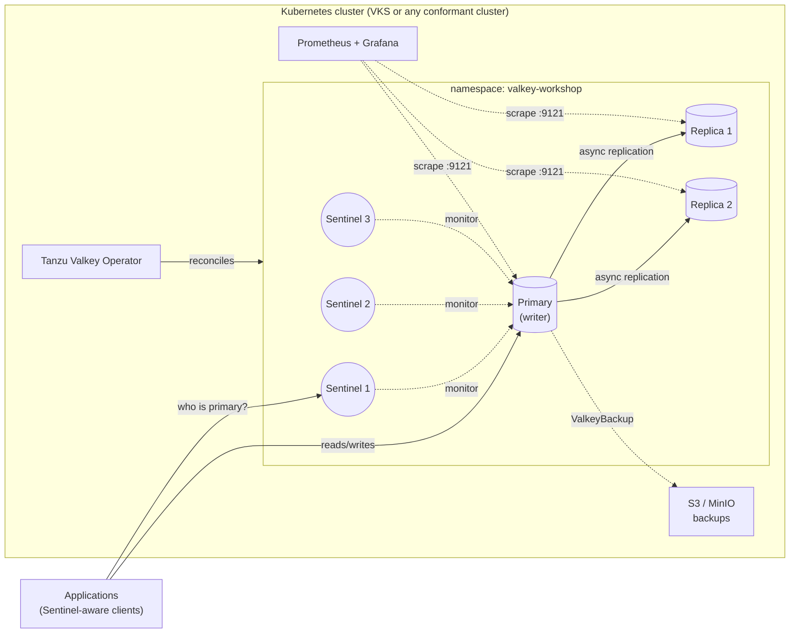

# Operating Highly Available Valkey on Kubernetes with Tanzu for Valkey and Sentinel

**Hands-on workshop for the Operator / Platform persona**

This workshop teaches the people who *run* Valkey (platform engineers, SREs, DBAs and operations teams) how to install, secure, observe, protect, fail over, patch and troubleshoot a **Sentinel-based, highly available Valkey deployment** managed by the **Tanzu for Valkey on Kubernetes operator (3.5)**.

The reference platform is **vSphere Kubernetes Service (VKS)**. Every lab also runs on any conformant Kubernetes cluster (1.21 or later), such as TKG, EKS, AKS, GKE, OpenShift (with the noted value changes), or kind/minikube for practice. Platform-specific settings live in one file: [`env.sh`](env.sh).



---

## Learning objectives

When you finish, you will be able to:

1. Explain how Valkey Sentinel provides high availability and what it does *not* do.
2. Install the Tanzu Valkey operator and deploy a production-shaped `ValkeySentinel` instance.
3. Find the writer and the replicas at any moment, and the Kubernetes nodes they run on.
4. Manage connections, ACL users, Sentinel authentication, TLS and network policies.
5. Use the Broadcom tooling: `valkey-cli`, `valkey-benchmark`, Valkey Admin, Valkey Commander, the exporter and the MCP server.
6. Deploy Prometheus and Grafana (kube-prometheus-stack) and read the key Valkey metrics: CPU, memory, fragmentation, hit rate, network, connections and replication.
7. Access and analyze operator, Valkey and Sentinel logs.
8. Run planned and unplanned failovers of the writer and understand client impact.
9. Back up, restore and replicate to a DR site.
10. Patch and upgrade the operator, the sidecar images and the Valkey version.
11. Troubleshoot the most common failure modes with a runbook.

## Workshop agenda

| # | Module | What you do | Time |
|---|--------|-------------|------|
| 0 | [Introduction to Valkey Sentinel and its architecture](docs/00-introduction-sentinel-architecture.md) | Concepts, diagrams, failure scenarios and how the operator maps Sentinel onto Kubernetes | 30 min |
| 1 | [Prerequisites and lab environment](docs/01-prerequisites.md) | Tools, cluster checks (VKS notes), `env.sh`, registry access, cert-manager | 20 min |
| 2 | [Install the Tanzu Valkey Operator](docs/02-install-operator.md) | Helm install, CRDs, webhooks, `ValkeyImageSet`, schema discovery with `kubectl explain` | 20 min |
| 3 | [Deploy a highly available ValkeySentinel](docs/03-deploy-valkey-sentinel.md) | Secrets, ACLs, persistence, anti-affinity, PDBs, resources | 30 min |
| 4 | [Topology: where are the writer and the replicas?](docs/04-topology-writer-replicas.md) | Roles, pods, nodes, zones, replication offsets, `topology.sh` | 20 min |
| 5 | [Connections and security](docs/05-connections-and-security.md) | Services, Sentinel-aware clients, ACL users, Sentinel auth, NetworkPolicy, TLS, OAuth/LDAP | 45 min |
| 6 | [Broadcom tools: CLI and web consoles](docs/06-tools-cli-and-web-consoles.md) | `valkey-cli` deep dive, `valkey-benchmark`, Valkey Admin, Valkey Commander, MCP Server | 40 min |
| 7 | [Metrics with Prometheus and Grafana](docs/07-metrics-prometheus-grafana.md) | kube-prometheus-stack, exporter, PodMonitor, dashboard, alert rules, PromQL | 50 min |
| 8 | [Logs: access and analysis](docs/08-logs.md) | Operator, Valkey and Sentinel logs, Sentinel event vocabulary, events, optional Loki | 30 min |
| 9 | [Failover of the writer](docs/09-failover.md) | Planned `SENTINEL FAILOVER`, crash, hung primary, node drain; client impact | 45 min |
| 10 | [Backup, restore and disaster recovery](docs/10-backup-restore-dr.md) | MinIO, backup location, on-demand and scheduled backups, restore, cross-cluster replication | 50 min |
| 11 | [Patching and upgrades](docs/11-patching-and-upgrades.md) | Operator upgrade, sidecar patching with `ValkeyImageSet`, Valkey version upgrade, node upgrades | 35 min |
| 12 | [Troubleshooting runbook and day-2 checklist](docs/12-troubleshooting-runbook.md) | Symptom → diagnosis → fix, diagnostics bundle | 30 min |
| 99 | [Cleanup](docs/99-cleanup.md) | Tear everything down in the right order | 10 min |

**Total: about 7.5 hours (one full day).** For a half-day version, run modules 0–4, 6, 7 and 9, and demo 10 and 11.

> The workshop order is deliberate. You deploy first, learn to *see* the system (topology, tools, metrics, logs), and only then break it (failover). The failover lab is far more instructive when Grafana and the Sentinel logs are already open next to it.

## Repository layout

```
.
├── README.md                 <- you are here
├── env.sh                    <- the ONLY file you edit (namespaces, versions, service types)
├── docs/                     <- workshop modules (00 ... 12, 99)
├── manifests/                <- YAML for every lab, grouped by module
│   ├── 02-operator/          Helm values for the operator
│   ├── 03-sentinel/          namespace, secrets, ACLs, ValkeySentinel CR
│   ├── 05-security/          Sentinel auth, NetworkPolicy, TLS (cert-manager), LoadBalancer
│   ├── 06-tools/             client pod, Valkey Admin / Commander
│   ├── 07-monitoring/        kube-prometheus-stack values, exporter, PodMonitor, alert rules
│   ├── 08-logging/           optional Loki + Alloy
│   ├── 10-backup-dr/         MinIO, backup location/schedule, restore, DR replication
│   └── 11-upgrades/          ValkeyVersionUpgrade, ValkeyImageSet example
├── monitoring/dashboards/    Grafana dashboard JSON (Tanzu Valkey - Sentinel HA Overview)
└── scripts/                  helpers (render, topology, health check, diagnostics, client scripts)
```

### How manifests are applied

Manifests contain `${VARIABLES}` from `env.sh`. The `render` helper substitutes **only** the workshop variables. Prometheus `{{ $labels }}` and similar strings are left alone.

```bash
source ./env.sh
render manifests/03-sentinel/03-valkey-sentinel.yaml                  # preview
render manifests/03-sentinel/03-valkey-sentinel.yaml | kubectl apply -f -
patch-sentinel.sh manifests/06-tools/04-consoles-patch.yaml          # merge-patch the Sentinel CR
```

## Conventions used in the labs

| Symbol | Meaning |
|--------|---------|
| `$ command` | Run on your workstation (with `env.sh` sourced) |
| 🔎 **Check** | Expected result and how to verify it |
| ⚠️ **Caution** | Production gotcha or potential outage |
| 📘 **Docs** | Link to the official Broadcom documentation |
| 🧠 **Operator insight** | Why it matters when you run this in production |

## Reference documentation

| Topic | Link |
|-------|------|
| Tanzu for Valkey on Kubernetes 3.5 (index) | https://techdocs.broadcom.com/us/en/vmware-tanzu/data-solutions/tanzu-for-valkey-on-kubernetes/3-5/valkey-on-kubernetes/index.html |
| Release notes | https://techdocs.broadcom.com/us/en/vmware-tanzu/data-solutions/tanzu-for-valkey-on-kubernetes/3-5/valkey-on-kubernetes/release-notes.html |
| Install the operator | https://techdocs.broadcom.com/us/en/vmware-tanzu/data-solutions/tanzu-for-valkey-on-kubernetes/3-5/valkey-on-kubernetes/install-operator.html |
| Architecture | https://techdocs.broadcom.com/us/en/vmware-tanzu/data-solutions/tanzu-for-valkey-on-kubernetes/3-5/valkey-on-kubernetes/architecture.html |
| CR property reference | https://techdocs.broadcom.com/us/en/vmware-tanzu/data-solutions/tanzu-for-valkey-on-kubernetes/3-5/valkey-on-kubernetes/property-reference-valkey.html |
| Troubleshooting | https://techdocs.broadcom.com/us/en/vmware-tanzu/data-solutions/tanzu-for-valkey-on-kubernetes/3-5/valkey-on-kubernetes/troubleshooting.html |
| Tanzu Valkey 9.1 (VM / OCI image, Valkey Admin UI, modules) | https://techdocs.broadcom.com/us/en/vmware-tanzu/data-solutions/tanzu-valkey/9-1/tanzu-valkey-docs/index.html |
| Valkey Sentinel (upstream) | https://valkey.io/topics/sentinel/ |

## Versions used

| Component | Version |
|-----------|---------|
| Tanzu for Valkey on Kubernetes operator | 3.5.1 |
| Valkey | `valkey-9.0.6` (deployed), then upgraded to `valkey-9.1.2` (module 11) |
| Kubernetes | 1.21 or later (validated by Broadcom on VKS and OpenShift) |
| Helm | 3.8 or later |
| kube-prometheus-stack | latest from prometheus-community |

> **A note on field names.** All manifests follow the 3.5 CR property reference. If a field is rejected on your operator build, `kubectl explain <kind>.spec --recursive` is the source of truth. Module 2 shows how to use it.
