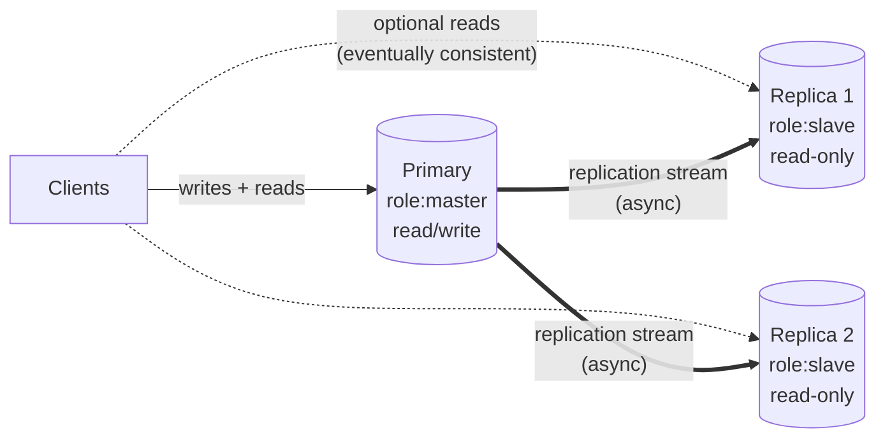
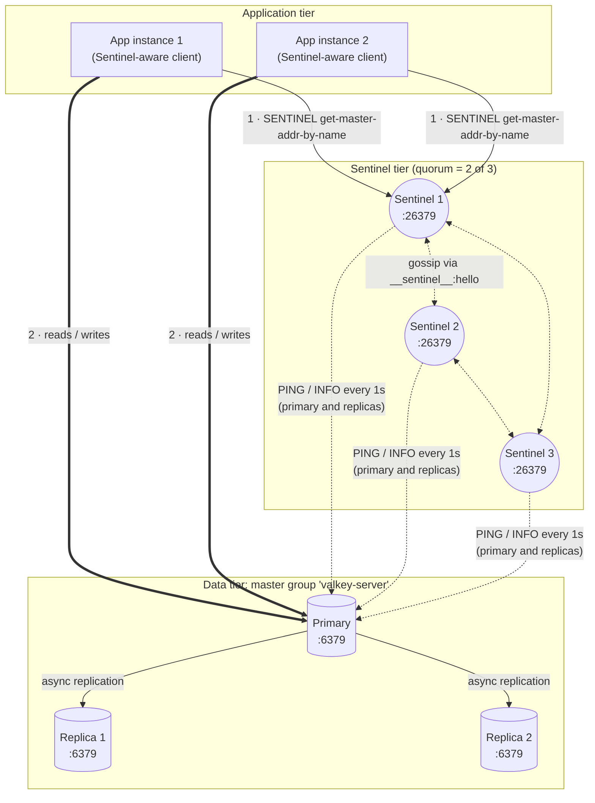
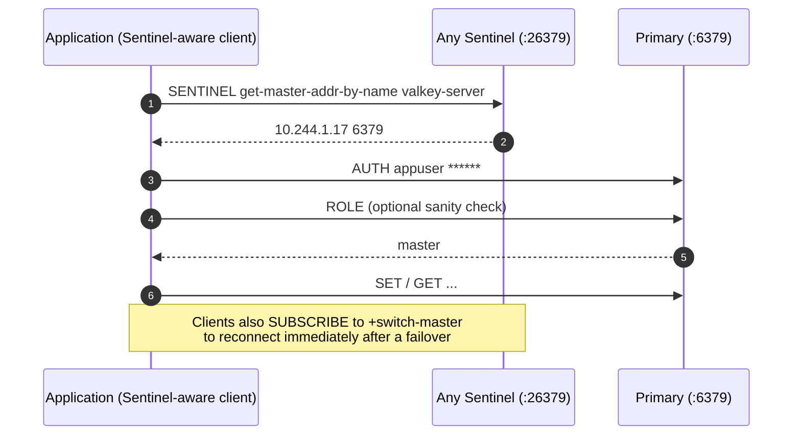
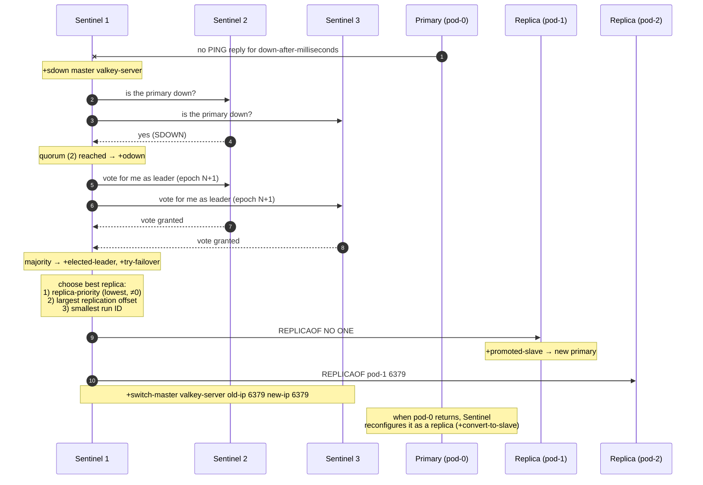
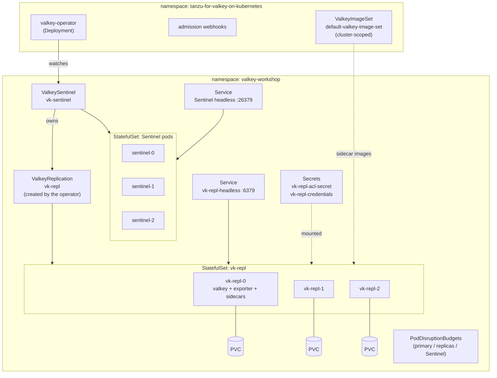
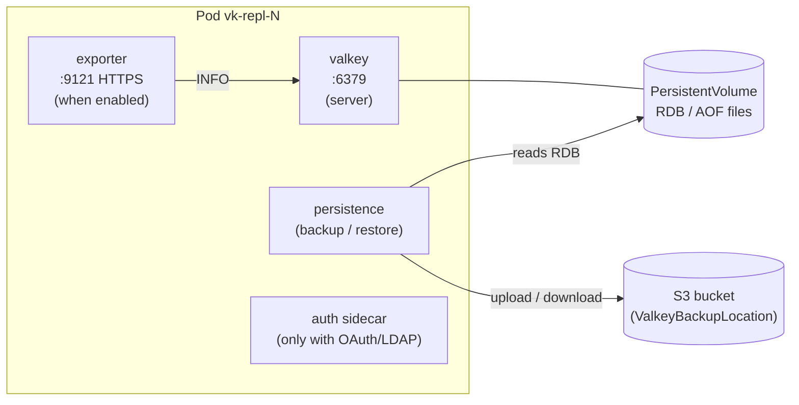

# Module 0: Introduction to Valkey Sentinel and its architecture

[← Back to README](../README.md) | Next: [Module 1: Prerequisites →](01-prerequisites.md)

**Goal:** build a mental model of how Valkey Sentinel keeps a primary/replica deployment available, what can go wrong, and how the Tanzu operator maps Sentinel onto Kubernetes objects. Every later lab builds on this model.

---

## 0.1 Valkey in one paragraph

[Valkey](https://valkey.io) is an open source (BSD), in-memory key/value data store forked from Redis 7.2.4 under the Linux Foundation. It is wire-compatible with Redis clients. Typical uses are caching, session storage, rate limiting, leaderboards, queues and pub/sub. Valkey keeps the whole dataset **in RAM** and executes commands on a **single main thread** (I/O threads help with networking). This is why memory and single-core CPU are the two resources you will watch most closely as an operator.

**Tanzu for Valkey** is Broadcom's supported distribution. It adds hardened images, an operator for Kubernetes, a Prometheus exporter, backup and restore to S3, OAuth/LDAP authentication, modules (JSON, Bloom, Search, LDAP), Valkey Admin, Valkey Commander and an MCP server.

📘 **Docs:** [Tanzu for Valkey 9.1 overview](https://techdocs.broadcom.com/us/en/vmware-tanzu/data-solutions/tanzu-valkey/9-1/tanzu-valkey-docs/index.html) · [Tanzu for Valkey on Kubernetes 3.5](https://techdocs.broadcom.com/us/en/vmware-tanzu/data-solutions/tanzu-for-valkey-on-kubernetes/3-5/valkey-on-kubernetes/index.html)

## 0.2 Deployment types offered by the operator

| CR kind | Topology | HA | Use it for |
|---------|----------|----|------------|
| `Valkey` | 1 standalone pod | ❌ | dev/test, caches you can lose |
| `ValkeyReplication` | 1 primary + N replicas | Read scaling and data copies, **no automatic failover** | read-heavy workloads where a human may promote a replica |
| **`ValkeySentinel`** | **Sentinels + a `ValkeyReplication`** | ✅ **automatic failover** | **production and business-critical workloads that need HA but not horizontal write scaling** |

This workshop focuses on **`ValkeySentinel`**. The Broadcom decision guide recommends it when you need high availability with automatic failover. It also requires **at least 6 pods** (3 Sentinels + 3 data pods).

📘 **Docs:** [Choose the right deployment type](https://techdocs.broadcom.com/us/en/vmware-tanzu/data-solutions/tanzu-for-valkey-on-kubernetes/3-5/valkey-on-kubernetes/choose-deployment-type.html)

## 0.3 Primary/replica replication



Key facts for operators:

- **Exactly one writer.** Only the primary accepts writes. A write sent to a replica fails with `READONLY You can't write against a read only replica`.
- **Replication is asynchronous.** The primary acknowledges a write *before* replicas receive it. If the primary dies, writes that had not reached a replica are lost. The window is usually milliseconds, but it is never zero.
- **Replication offset.** Every node tracks a byte offset in the replication stream. *Primary offset − replica offset* = replication lag in bytes. You will read this in module 4 and graph it in module 7.
- **Full vs partial resync.** A replica that reconnects after a short break continues from the replication backlog (*partial resync*). If it was gone too long, it needs a *full resync*: the primary forks, writes an RDB snapshot and streams it. That is expensive in CPU, memory (copy-on-write) and network.

## 0.4 What Sentinel adds

**Sentinel** is a separate Valkey process (`valkey-sentinel`, port **26379**) that provides:

| Capability | What it means |
|------------|---------------|
| **Monitoring** | Every Sentinel PINGs the primary, the replicas and the other Sentinels about once per second. |
| **Automatic failover** | If the primary is unreachable, the Sentinels agree on it, elect a leader, promote the best replica, and repoint the other replicas. |
| **Configuration provider (service discovery)** | Clients ask Sentinel *"who is the primary of `valkey-server`?"* and connect there. |
| **Notification** | Sentinel publishes events (`+sdown`, `+odown`, `+switch-master`, …) on pub/sub channels and in its log. |

> ⚠️ **Sentinel is *not* a proxy.** Application traffic never flows through Sentinel. Clients must be **Sentinel-aware**: they discover the primary from Sentinel, then talk to the primary directly. After a failover they rediscover it. Most mature client libraries support this: Lettuce and Jedis (Java/Spring), redis-py and valkey-py, go-redis and valkey-go, ioredis and iovalkey, StackExchange.Redis and others.

### 0.4.1 Logical architecture



### 0.4.2 Client discovery flow



## 0.5 How a failover works

Sentinel uses two levels of "down":

| State | Meaning | Who decides |
|-------|---------|-------------|
| **SDOWN** (subjectively down) | *This* Sentinel has not received a valid PING reply for `down-after-milliseconds`. | each Sentinel on its own |
| **ODOWN** (objectively down) | At least **quorum** Sentinels report SDOWN for the primary. | the Sentinels collectively |

ODOWN only *triggers* a failover. To actually **perform** it, a Sentinel must be elected leader by a **majority** of all known Sentinels (2 of 3, or 3 of 5). Quorum and majority are different numbers, so it is worth memorizing both.



**Timeline of a typical failover** (workshop settings: `downAfterMilliseconds=5000`):

```
t=0s        primary stops answering
t≈5s        each Sentinel flags +sdown
t≈5-6s      quorum reached → +odown, leader election (+try-failover, +elected-leader)
t≈6-7s      replica promoted (+promoted-slave), +switch-master published
t≈7-8s      clients that listen to +switch-master or retry discovery reconnect
            → writes fail for roughly down-after-milliseconds + 1-3 s
```

With the operator default `downAfterMilliseconds=30000`, expect about 30–35 s of write unavailability for an *unplanned* failure. A *planned* `SENTINEL FAILOVER` skips detection and usually completes in 1–3 s.

## 0.6 Quorum, majority and sizing

| Sentinels | Recommended quorum | Majority for leader election | Sentinels you can lose and still fail over |
|-----------|--------------------|------------------------------|--------------------------------------------|
| 1 | 1 | 1 | 0, and no HA for Sentinel itself ❌ |
| 2 | 1 or 2 | 2 | 0 ❌ (never use 2) |
| **3** | **2** | **2** | **1** ✅ (operator default) |
| 5 | 3 | 3 | 2 ✅ (large / multi-zone) |

Rules of thumb:

- Always run an **odd** number of Sentinels (3 or 5), on **different worker nodes** and ideally **different zones**.
- Run **at least 2 replicas** (3 data pods) so a failover leaves you with a primary *and* a replica.
- Put data pods on different nodes than each other (anti-affinity). If the node hosting the primary dies, the remaining Sentinels still need a majority.

## 0.7 Failure scenarios every operator should know

| Scenario | What happens | Data loss? | Operator action |
|----------|--------------|-----------|-----------------|
| Primary container crashes and restarts quickly | Kubernetes restarts the container. If it is back before `down-after-milliseconds`, **no failover** happens. It reloads the last RDB/AOF from its PVC, and the replicas **resync from it**. | Yes: writes since the last save are lost on *all* nodes, because the replicas copy the restarted primary | Prefer AOF or frequent RDB saves; check logs and restart count (modules 8 and 12) |
| Primary pod/node down longer than `down-after-milliseconds` | Automatic failover; the old primary rejoins as a replica. | Writes not yet replicated (usually ms) | Verify topology, investigate the root cause |
| One replica down | No failover. Reads served by the remaining nodes. | None | Replace or fix; watch for full resync |
| One Sentinel down | Nothing visible; 2 of 3 still form quorum and majority. | None | Restore it; you now tolerate zero more Sentinel failures |
| Two Sentinels down | **No automatic failover possible** (no majority). Data path still works. | None (yet) | Urgent: restore Sentinels |
| Network partition isolates the primary with a minority of Sentinels | The majority side promotes a new primary. The old primary keeps accepting writes from clients on its side until the partition heals; those writes are **discarded** when it rejoins as a replica. | Yes: writes to the isolated old primary | Mitigate with `min-replicas-to-write`. Alert on *multiple primaries* (module 7) |
| Full resync storm after a long outage | High CPU, memory spikes (fork copy-on-write) and network saturation on the primary | No | Size memory headroom (about 2× dataset for fork), stagger restarts (`parallelSyncs`) |

🧠 **Operator insight:** Sentinel guarantees **availability**, not **zero data loss**. If the business needs RPO = 0 for some data, that data belongs in a system with synchronous replication or a durable log. Use Valkey for what it is excellent at, and know your RPO (module 10).

## 0.8 How the Tanzu operator maps Sentinel onto Kubernetes



**What lives inside a Valkey data pod**



**Division of responsibility**

| Concern | Who handles it |
|---------|----------------|
| Detect primary failure, promote replica, repoint replicas | **Sentinel** |
| Create and repair pods, PVCs, services, PDBs and config; apply CR changes | **Operator** (reconcile loop) and **StatefulSet controller** |
| Restart crashed containers, reschedule pods from failed nodes | **Kubernetes** (kubelet, scheduler) |
| Discover the primary, reconnect after failover, retry | **Client library** |
| Capacity, alerting, backups, upgrades, access control, runbooks | **You, the operator persona** ← this workshop |

> ⚠️ Never scale the StatefulSets with `kubectl scale`, and never edit the generated `ValkeyReplication` behind Sentinel's back. The operator reverts manual changes. Change the **`ValkeySentinel` CR** instead.

## 0.9 Persistence and HA are complementary

| Mechanism | Protects against | Does not protect against |
|-----------|------------------|--------------------------|
| Replication + Sentinel | Loss of a pod or node; gives fast failover | Bad writes, `FLUSHALL`, corruption (these replicate instantly!) |
| RDB snapshots / AOF on PVCs | Full restart of all pods | Loss of the storage or the cluster |
| `ValkeyBackup` to S3 | Logical mistakes, cluster or site loss | Data written after the last backup |
| DR replica in another cluster | Site loss, with RPO of seconds | Logical mistakes (they replicate too) |

You will configure every row of this table during the workshop.

## 0.10 Knowledge check

1. Three Sentinels, quorum 2. Two Sentinels are down. Is the data path affected? Can a failover happen?
2. Why does a write to a replica fail, and what does a Sentinel-aware client do differently?
3. A client wrote a key, got `OK`, and the primary crashed 2 ms later. Is the key guaranteed to exist after failover?
4. Which takes longer: `SENTINEL FAILOVER` or a crashed primary? Why?
5. Which object should you edit to change the number of replicas: the StatefulSet, the `ValkeyReplication` or the `ValkeySentinel`?

<details>
<summary>Answers</summary>

1. The data path keeps working (Sentinel is not a proxy), but **no failover** can happen, because a majority (2 of 3) is needed to elect a leader.
2. Replicas are read-only (`READONLY` error). A Sentinel-aware client asks Sentinel for the current primary and sends writes there.
3. No. Replication is asynchronous, so the write may not have reached any replica.
4. A crashed primary takes longer: Sentinel must first wait `down-after-milliseconds` to detect the failure. A manual failover skips detection.
5. The `ValkeySentinel` CR (`spec.valkeyReplicationConfig.size`).
</details>

---

[← Back to README](../README.md) | Next: [Module 1: Prerequisites →](01-prerequisites.md)
