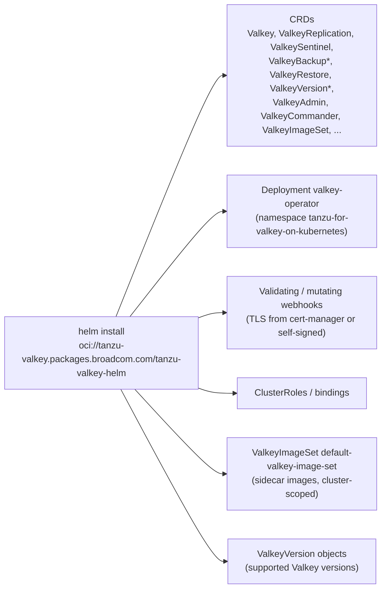

# Module 2: Install the Tanzu Valkey Operator

[← Module 1](01-prerequisites.md) | [README](../README.md) | Next: [Module 3: Deploy ValkeySentinel →](03-deploy-valkey-sentinel.md)

**Goal:** install the Tanzu for Valkey on Kubernetes operator with Helm, verify the CRDs, webhooks and image set, and learn to discover the CR schema yourself.

📘 **Docs:** [Install Tanzu for Valkey on Kubernetes](https://techdocs.broadcom.com/us/en/vmware-tanzu/data-solutions/tanzu-for-valkey-on-kubernetes/3-5/valkey-on-kubernetes/install-operator.html) · [Architecture](https://techdocs.broadcom.com/us/en/vmware-tanzu/data-solutions/tanzu-for-valkey-on-kubernetes/3-5/valkey-on-kubernetes/architecture.html)

---

## 2.1 What gets installed



## 2.2 Log in to the Broadcom registry

```bash
source ./env.sh
echo "${REGISTRY_PASSWORD}" | helm registry login "${REGISTRY_SERVER}" \
  --username "${REGISTRY_USERNAME}" --password-stdin
```

🔎 **Check:** `Login Succeeded`

## 2.3 Create the namespace and the image pull secret

The pull secret `valkey-registry-secret` must exist in the **operator namespace and every namespace where Valkey instances run**. Without it, instance pods end in `ImagePullBackOff`.

```bash
kubectl create namespace "${OPERATOR_NS}" --dry-run=client -o yaml | kubectl apply -f -

kubectl create secret docker-registry valkey-registry-secret \
  --namespace "${OPERATOR_NS}" \
  --docker-server="https://${REGISTRY_SERVER}/" \
  --docker-username="${REGISTRY_USERNAME}" \
  --docker-password="${REGISTRY_PASSWORD}" \
  --dry-run=client -o yaml | kubectl apply -f -
```

🧠 **Operator insight:** in production, distribute this secret with a GitOps tool, External Secrets Operator or a policy engine (for example a Kyverno *generate* rule) so every new Valkey namespace gets it automatically. Better still, relocate the images to your internal registry (Harbor) and point the chart's image repository values at it.

## 2.4 Review the Helm values

Look at the chart's default values and the overrides used in this workshop:

```bash
helm show values oci://${REGISTRY_SERVER}/tanzu-valkey-helm --version "${OPERATOR_VERSION}" | less
cat manifests/02-operator/operator-values.yaml
```

| Value | Default | Workshop | Notes |
|-------|---------|----------|-------|
| `certManager.enabled` | `true` | `true` | `false` → operator self-signs and renews its webhook certificate |
| `kubernetesClusterDomain` | `cluster.local` | `$CLUSTER_DOMAIN` | must match the cluster DNS suffix, or TLS and DNS break |
| `watchNamespaces` | `[]` (all) | `[]` | restrict in multi-tenant clusters |
| `imagePullSecretName` | `valkey-registry-secret` | same | the secret name looked up in instance namespaces |
| `enableSecurityContext` | `true` | `true` | set `false` only on OpenShift |
| `operator.resources` | 1 CPU / 1Gi | 500m–1 CPU / 512Mi–1Gi | |
| `operator.nodeSelector/tolerations/affinity` | empty | empty | pin to a platform node pool if you have one |

## 2.5 Install the operator

```bash
helm upgrade --install "${OPERATOR_RELEASE}" \
  oci://${REGISTRY_SERVER}/tanzu-valkey-helm \
  --version "${OPERATOR_VERSION}" \
  --namespace "${OPERATOR_NS}" \
  -f manifests/02-operator/operator-values.yaml \
  --set kubernetesClusterDomain="${CLUSTER_DOMAIN}" \
  --wait
```

> No cert-manager? Add `--set certManager.enabled=false`.
>
> Air-gapped? `helm pull oci://${REGISTRY_SERVER}/tanzu-valkey-helm --version ${OPERATOR_VERSION} --untar --untardir /tmp`, relocate the images, and install from `/tmp/tanzu-valkey-helm`.

⚠️ **Caution:** keep `operator-values.yaml` under version control. Helm re-applies your overrides on `helm upgrade` only if you pass the file again (module 11).

## 2.6 Verify the installation

```bash
helm list -n "${OPERATOR_NS}"
kubectl get all -n "${OPERATOR_NS}"
kubectl get crd | grep -i valkey
kubectl get validatingwebhookconfigurations,mutatingwebhookconfigurations | grep -i valkey
kubectl logs -n "${OPERATOR_NS}" deploy/${OPERATOR_DEPLOY} --tail=30
```

🔎 **Check:**

- The `valkey-operator` pod is `Running` and `1/1` ready.
- CRDs include `valkeysentinels.data.tanzu.vmware.com`, `valkeyreplications…`, `valkeybackups…`, `valkeyrestores…`, `valkeyversionupgrades…`, `valkeyimagesets…`, `valkeyadmins…`.
- The logs show controllers starting with no repeated errors.

> If the deployment is not called `valkey-operator`, run `kubectl get deploy -n $OPERATOR_NS` and set `OPERATOR_DEPLOY` in `env.sh`.

### Supported Valkey versions

The operator publishes the versions it supports as `ValkeyVersion` objects:

```bash
kubectl get valkeyversions
```

🔎 **Check:** both `$VALKEY_VERSION` (`valkey-9.0.6`) and `$VALKEY_TARGET_VERSION` (`valkey-9.1.2`) are listed. If not, pick two listed versions and update `env.sh`.

### The ValkeyImageSet (sidecar images)

```bash
kubectl get valkeyimageset            # short name: vkimageset
kubectl get valkeyimageset default-valkey-image-set -o yaml
```

This cluster-scoped object defines the **companion images** used by every instance: `exporter`, `persistence` (backup/restore), `auth` (OAuth/LDAP), `commander`, `admin`, `modules` and `mcp`. You will use it for patching in module 11.

## 2.7 Discover the CR schema yourself

Your most useful habit as a Valkey operator is to ask the cluster which fields a CR accepts. The answer always matches the operator version you actually run.

```bash
kubectl api-resources --api-group=data.tanzu.vmware.com      # kinds and short names
kubectl explain valkeysentinel.spec                          # top-level fields
kubectl explain valkeysentinel.spec.valkeySentinelConfig     # quorum, downAfterMilliseconds, ...
kubectl explain valkeysentinel.spec.valkeyReplicationConfig  # name, size, affinity, PDB, ...
kubectl explain valkeysentinel.spec --recursive | less       # everything
kubectl explain valkeybackuplocation.spec.storage.s3
```

🧠 **Operator insight:** if a manifest from this workshop (or from the docs) is rejected by the admission webhook, compare it with `kubectl explain`. Field names occasionally change between operator releases. For example, 3.5.0 removed `spec.valkeySentinelConfig.valkeyReplicationSize` in favour of `spec.valkeyReplicationConfig.size`. The [release notes](https://techdocs.broadcom.com/us/en/vmware-tanzu/data-solutions/tanzu-for-valkey-on-kubernetes/3-5/valkey-on-kubernetes/release-notes.html) list such changes.

## 2.8 Operator troubleshooting quick reference

| Symptom | Likely cause | Check / fix |
|---------|--------------|-------------|
| `helm install` → 401/403 | registry login or entitlement | `helm registry login ...` again; check the Support Portal entitlement |
| Operator pod `ImagePullBackOff` | missing/wrong `valkey-registry-secret` in `$OPERATOR_NS` | recreate the secret (2.3) |
| Operator pod `Pending` | resources, nodeSelector or taints | `kubectl describe pod -n $OPERATOR_NS -l app.kubernetes.io/name=tanzu-valkey-helm` |
| CR apply fails: `failed calling webhook` | webhook certificate not ready (cert-manager) | `kubectl get certificate -n $OPERATOR_NS`; cert-manager logs |
| CRs are ignored in a namespace | `watchNamespaces` excludes it | add the namespace, `helm upgrade` |
| `CrashLoopBackOff` on OpenShift | security context | `--set enableSecurityContext=false` |

📘 **Docs:** [Troubleshooting → Installation](https://techdocs.broadcom.com/us/en/vmware-tanzu/data-solutions/tanzu-for-valkey-on-kubernetes/3-5/valkey-on-kubernetes/troubleshooting.html)

---

[← Module 1](01-prerequisites.md) | [README](../README.md) | Next: [Module 3: Deploy ValkeySentinel →](03-deploy-valkey-sentinel.md)
