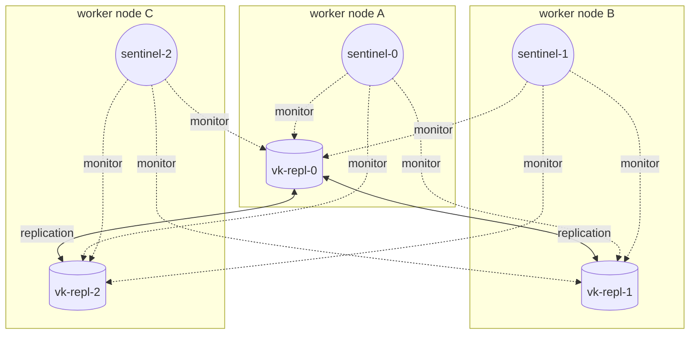

# Module 3: Deploy a highly available ValkeySentinel

[← Module 2](02-install-operator.md) | [README](../README.md) | Next: [Module 4: Topology →](04-topology-writer-replicas.md)

**Goal:** deploy a production-shaped Sentinel instance (3 Sentinels, 1 primary, 2 replicas) with authentication, ACL users, persistence, anti-affinity, PodDisruptionBudgets and resource limits. Then watch the operator reconcile it.

📘 **Docs:** [Create and delete instances](https://techdocs.broadcom.com/us/en/vmware-tanzu/data-solutions/tanzu-for-valkey-on-kubernetes/3-5/valkey-on-kubernetes/create-delete-instances.html) · [Enable persistence](https://techdocs.broadcom.com/us/en/vmware-tanzu/data-solutions/tanzu-for-valkey-on-kubernetes/3-5/valkey-on-kubernetes/persistence.html) · [Configure ACL](https://techdocs.broadcom.com/us/en/vmware-tanzu/data-solutions/tanzu-for-valkey-on-kubernetes/3-5/valkey-on-kubernetes/configure-acl.html) · [CR property reference](https://techdocs.broadcom.com/us/en/vmware-tanzu/data-solutions/tanzu-for-valkey-on-kubernetes/3-5/valkey-on-kubernetes/property-reference-valkey.html)

---

## 3.1 What you are about to build



*Which* pod is the primary is decided at runtime. Module 4 shows how to find it.

## 3.2 Create the namespace and the pull secret

```bash
source ./env.sh
render manifests/03-sentinel/00-namespace.yaml | kubectl apply -f -

kubectl create secret docker-registry valkey-registry-secret \
  --namespace "${VALKEY_NS}" \
  --docker-server="https://${REGISTRY_SERVER}/" \
  --docker-username="${REGISTRY_USERNAME}" \
  --docker-password="${REGISTRY_PASSWORD}" \
  --dry-run=client -o yaml | kubectl apply -f -
```

## 3.3 Credentials and ACL users

Two secrets, two different purposes:

| Secret | Referenced by | Used for |
|--------|---------------|----------|
| `vk-repl-credentials` | `spec.kubernetesConfig.valkeySecret` | The **platform identity**: operator heartbeat, Sentinel → Valkey auth (`sentinel auth-user/auth-pass`), replica → primary auth, exporter |
| `vk-repl-acl-secret` | `spec.acl.secret.secretName` | The **ACL file** (`user.acl`) loaded by every data pod |

The ACL file in [`02-acl-secret.yaml`](../manifests/03-sentinel/02-acl-secret.yaml) defines four users:

| User | Rules (abridged) | Who uses it |
|------|------------------|-------------|
| `default` | `on >*** ~* &* +@all` | platform components (must exist and **must have a password**) |
| `admin` | `on >*** ~* &* +@all` | human operators (named and auditable) |
| `appuser` | `~app:* +@read +@write +@connection +@transaction -@dangerous` | applications (only `app:*` keys) |
| `monitor` | `-@all +@read +info +ping +client\|list +slowlog\|get …` | read-only troubleshooting |

⚠️ **Caution, three rules from the Broadcom ACL guide:**

1. The secret **must** be named `<instance-name>-acl-secret`. For a `ValkeySentinel`, `<instance-name>` is `spec.valkeyReplicationConfig.name` (`vk-repl`), **not** the Sentinel name. Any other name is silently ignored.
2. If ACLs are enabled and `default` is `on` **without a password**, Valkey stays in **protected mode** and rejects every non-loopback connection with `DENIED Running in protected mode`. That includes Sentinel, replicas and the exporter.
3. The `valkeySecret` user must exist in the ACL file and must be allowed to run `PING` (`+ping` or `+@connection`), or the operator heartbeat fails and the pods never become Ready.

Apply both secrets:

```bash
render manifests/03-sentinel/01-valkey-credentials-secret.yaml | kubectl apply -f -
render manifests/03-sentinel/02-acl-secret.yaml | kubectl apply -f -
kubectl get secrets -n "${VALKEY_NS}"
```

## 3.4 Review the ValkeySentinel CR

Open [`manifests/03-sentinel/03-valkey-sentinel.yaml`](../manifests/03-sentinel/03-valkey-sentinel.yaml) and walk through each block:

| Block | Field(s) | Workshop value | Production guidance |
|-------|----------|----------------|---------------------|
| Version | `valkeyVersion.name` | `valkey-9.0.6` | pin explicitly; upgrade with `ValkeyVersionUpgrade` |
| Sentinel tier | `clusterSize` | 3 | 3, or 5 across 3 zones |
| | `valkeySentinelConfig.quorum` | "2" | majority of Sentinels |
| | `valkeySentinelConfig.downAfterMilliseconds` | **"5000"** (fast demo) | default 30000; 5000–15000 is common. Too low → false failovers during GC pauses, network blips or large `BGSAVE` forks |
| | `valkeySentinelConfig.failoverTimeout` | "60000" | default 180000 |
| | `valkeySentinelConfig.parallelSyncs` | "1" | keep 1 so replicas don't all resync at once |
| | `podDisruptionBudget.enabled` | true | `minAvailable` defaults to the quorum |
| | `affinity` | preferred anti-affinity on hostname | use *required*, plus zone spread, in production |
| Data tier | `valkeyReplicationConfig.name` | `vk-repl` | the operator creates this `ValkeyReplication` |
| | `valkeyReplicationConfig.size` | 3 | ≥ 3 (1 primary + 2 replicas) |
| | `valkeyReplicationConfig.podDisruptionBudget` | enabled | separate primary and replica PDBs |
| | `valkeyReplicationConfig.affinity` | preferred anti-affinity | *required* anti-affinity plus `topologySpreadConstraints` on zones |
| | `valkeyReplicationConfig.maxClients` | 10000 | size to your client pools (fd limits apply) |
| Persistence | `persistence.storageSize`, `rdb.entries` | 2Gi, RDB save points | **required for backups and version upgrades**. Size the PVC ≥ 2× dataset; consider AOF (`persistence.aof.fsyncPolicy: everysec`) for a smaller data-loss window |
| Security | `acl.secret.secretName`, `kubernetesConfig.valkeySecret` | see 3.3 | |
| Network | `kubernetesConfig.serviceType` | `ClusterIP` | `LoadBalancer` only with auth and TLS |
| Resources | `resources.instance`, `resources.sentinel` | 250m–1 CPU, 512Mi–1Gi | memory limit ≥ maxmemory × ~1.3–2 (fork copy-on-write, buffers, fragmentation) |

Preview the rendered manifest:

```bash
render manifests/03-sentinel/03-valkey-sentinel.yaml
```

## 3.5 Deploy

Open a second terminal (with `source ./env.sh`) and watch the pods appear:

```bash
kubectl get pods -n "${VALKEY_NS}" -o wide -w
```

In the first terminal:

```bash
render manifests/03-sentinel/03-valkey-sentinel.yaml | kubectl apply -f -
```

Watch the status of the CRs:

```bash
kubectl get valkeysentinel,valkeyreplication -n "${VALKEY_NS}"
kubectl describe valkeysentinel "${SENTINEL_NAME}" -n "${VALKEY_NS}" | tail -30
```

🔎 **Check** (after 1–3 minutes):

- `ValkeySentinel` and `ValkeyReplication` report a ready/running status.
- 3 data pods `vk-repl-0..2` are `Running` and Ready.
- 3 Sentinel pods are `Running`.
- The pods are spread across different nodes (`-o wide`, NODE column).

Follow the operator while it reconciles:

```bash
kubectl logs -n "${OPERATOR_NS}" deploy/${OPERATOR_DEPLOY} -f --since=5m
```

## 3.6 Inventory: what did the operator create?

```bash
kubectl get statefulsets,pods,svc,endpoints,pvc,pdb,secrets,configmaps -n "${VALKEY_NS}"
```

| Object | Expect | Purpose |
|--------|--------|---------|
| StatefulSet `vk-repl` | 3/3 | Valkey data pods (stable names, stable PVCs) |
| StatefulSet for Sentinel | 3/3 | Sentinel pods |
| Service `vk-repl-headless` | ClusterIP None, 6379 | per-pod DNS: `vk-repl-N.vk-repl-headless.<ns>.svc` |
| Service `vk-repl` | ClusterIP/LB | instance service |
| Sentinel headless service | ClusterIP None, 26379 | how clients find Sentinels |
| PVC × 3 | Bound | RDB/AOF data per data pod |
| PDB × 3 | primary, replicas, Sentinel | protect quorum and the writer during voluntary disruptions |

Inspect a data pod:

```bash
kubectl get pod vk-repl-0 -n "${VALKEY_NS}" -o jsonpath='{range .spec.containers[*]}{.name}{"  "}{.image}{"\n"}{end}'
kubectl get pod vk-repl-0 -n "${VALKEY_NS}" --show-labels
kubectl describe pdb -n "${VALKEY_NS}"
```

🧠 **Operator insight:** write down the container names and labels you see here. You will use them for logs (`-c <container>`), selectors and NetworkPolicies. If the Valkey container isn't the pod's default container, set `VALKEY_CONTAINER` in `env.sh`.

Test the helper functions loaded by `env.sh`:

```bash
repl_pods           # data pods
sentinel_pods       # Sentinel pods
sentinel_svc        # Sentinel headless service
vcli vk-repl-0 PING # valkey-cli as user "admin" -> PONG
scli PING           # valkey-cli against a Sentinel -> PONG
```

## 3.7 First contact with the data

```bash
vcli vk-repl-0 ROLE
vcli vk-repl-0 SET app:hello "world"
```

One of two things happens:

- `OK` → `vk-repl-0` is the primary.
- `(error) READONLY You can't write against a read only replica.` → it's a replica. That's exactly what module 4 is about.

Prove the ACLs work:

```bash
# appuser may only touch app:* keys
kubectl exec -n "${VALKEY_NS}" vk-repl-0 -- valkey-cli --user appuser --pass "${VALKEY_APP_PASSWORD}" --no-auth-warning GET other:key
# -> (error) NOPERM ... no permissions to access one of the keys

# appuser may not run admin commands
kubectl exec -n "${VALKEY_NS}" vk-repl-0 -- valkey-cli --user appuser --pass "${VALKEY_APP_PASSWORD}" --no-auth-warning CONFIG GET maxmemory
# -> (error) NOPERM ... has no permissions to run the 'config|get' command

# unauthenticated access is refused
kubectl exec -n "${VALKEY_NS}" vk-repl-0 -- valkey-cli PING
# -> (error) NOAUTH Authentication required.

vcli vk-repl-0 ACL LIST
```

## 3.8 Day-2 changes go through the CR

Everything you configure lives in the CR. The operator converges the cluster to it. Try a safe change, such as adding a pod annotation, and watch the rolling update:

```bash
kubectl patch valkeysentinel "${SENTINEL_NAME}" -n "${VALKEY_NS}" --type merge \
  -p '{"spec":{"kubernetesConfig":{"podAnnotations":{"workshop/owner":"platform-team"}}}}'
kubectl get pods -n "${VALKEY_NS}" -w
```

⚠️ **Caution:**

- Changes to probes, annotations, resources, TLS and similar fields **restart pods**. On a Sentinel deployment a restart of the primary pod triggers or risks a failover. Plan CR changes like any other maintenance (module 11).
- Don't `kubectl scale` or edit the StatefulSets. The operator reverts the change.
- Deleting a pod or StatefulSet only makes the operator recreate it. To delete the instance, delete the **CR** (module 99).

## 3.9 Memory limits and `maxmemory`

```bash
vcli vk-repl-0 CONFIG GET maxmemory
vcli vk-repl-0 CONFIG GET maxmemory-policy
vcli vk-repl-0 INFO memory | grep -E 'used_memory_human|maxmemory_human|mem_fragmentation_ratio'
```

If `maxmemory` is `0` (unlimited), Valkey grows until the **container memory limit**, and then the kubelet **OOMKills** the pod. On the primary, that causes a failover. Decide deliberately:

| Workload | `maxmemory` | `maxmemory-policy` |
|----------|-------------|--------------------|
| Pure cache | ~60–75 % of the container limit | `allkeys-lru` / `allkeys-lfu` |
| Data that must not be evicted (sessions, queues) | ~60–75 % of the container limit | `noeviction` (writes fail when full, but you get an alert instead of silent data loss) |

You will see the impact in Grafana in module 7 (memory vs maxmemory, evictions).

---

[← Module 2](02-install-operator.md) | [README](../README.md) | Next: [Module 4: Topology →](04-topology-writer-replicas.md)
