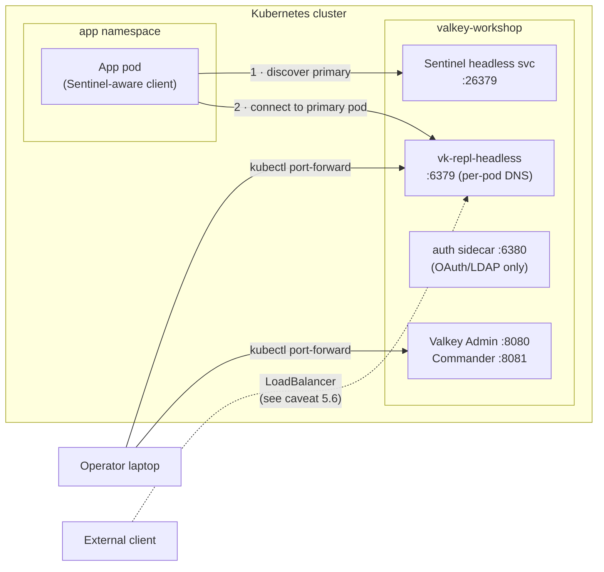
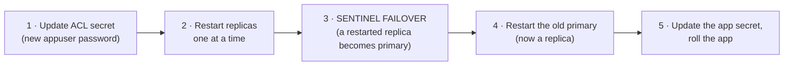
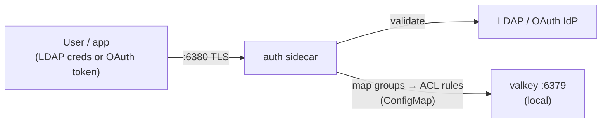

# Module 5: Connections and security

[← Module 4](04-topology-writer-replicas.md) | [README](../README.md) | Next: [Module 6: Tools and web consoles →](06-tools-cli-and-web-consoles.md)

**Goal:** understand every way to connect to the instance, configure Sentinel-aware clients, manage ACL users and password rotation, protect the Sentinel API, restrict network access, and (optionally) enable TLS.

📘 **Docs:** [Access instances](https://techdocs.broadcom.com/us/en/vmware-tanzu/data-solutions/tanzu-for-valkey-on-kubernetes/3-5/valkey-on-kubernetes/accessing.html) · [Connect applications](https://techdocs.broadcom.com/us/en/vmware-tanzu/data-solutions/tanzu-for-valkey-on-kubernetes/3-5/valkey-on-kubernetes/connecting-apps.html) · [Configure ACL](https://techdocs.broadcom.com/us/en/vmware-tanzu/data-solutions/tanzu-for-valkey-on-kubernetes/3-5/valkey-on-kubernetes/configure-acl.html) · [Configure TLS](https://techdocs.broadcom.com/us/en/vmware-tanzu/data-solutions/tanzu-for-valkey-on-kubernetes/3-5/valkey-on-kubernetes/configure-tls.html) · [OAuth and LDAP](https://techdocs.broadcom.com/us/en/vmware-tanzu/data-solutions/tanzu-for-valkey-on-kubernetes/3-5/valkey-on-kubernetes/auth.html) · [Service bindings](https://techdocs.broadcom.com/us/en/vmware-tanzu/data-solutions/tanzu-for-valkey-on-kubernetes/3-5/valkey-on-kubernetes/create-service-bindings.html)

---

## 5.1 Connection paths



| Method | Ports | Use case | Security |
|--------|-------|----------|----------|
| `kubectl port-forward` | 6379 / 26379 / 8080 / 8081 | admin, troubleshooting | uses your K8s RBAC; nothing exposed |
| ClusterIP / headless services (default) | 6379, 26379 | apps in the same cluster | internal only; restrict further with NetworkPolicy |
| LoadBalancer | 6379, 26379 | apps outside the cluster | requires ACLs **and** TLS; see caveat 5.6 |
| Auth sidecar | 6380 | OAuth/LDAP users | enforced identity; requires TLS |
| Web consoles | 8080 (Admin), 8081 (Commander) | GUI | Admin has no login, so keep it internal |

## 5.2 Service names and DNS

```bash
source ./env.sh
kubectl get svc -n "${VALKEY_NS}"
echo "Sentinel service: $(sentinel_svc)"
```

| Purpose | DNS name |
|---------|----------|
| Sentinel (for clients) | `<sentinel-headless-svc>.valkey-workshop.svc.cluster.local:26379` |
| A specific data pod | `vk-repl-N.vk-repl-headless.valkey-workshop.svc.cluster.local:6379` |
| Master group name | `valkey-server` |

Export the Sentinel FQDN. The client pod in module 6 uses it.

```bash
export SENTINEL_HOST="$(sentinel_svc).${VALKEY_NS}.svc.${CLUSTER_DOMAIN}"
echo "$SENTINEL_HOST"
```

## 5.3 Configuring Sentinel-aware applications

Applications need **five** things: the Sentinel endpoints, the master group name, the **Sentinel password** (`sentinelSecret`), and a **data** username and password (an ACL user such as `appuser`). They must **not** be configured with a fixed primary host.

> The two credentials are independent. The Sentinel password only lets the client ask Sentinel where the primary is. The ACL user decides what the client may do on the data nodes. Sentinel doesn't load the data-node ACL file, so `appuser` can't log in to Sentinel, and the Sentinel password can't log in to the data nodes.

<details>
<summary><b>Spring Boot (Lettuce): application.yaml</b></summary>

```yaml
spring:
  data:
    redis:
      username: appuser
      password: ${VALKEY_PASSWORD}          # from a Kubernetes Secret
      sentinel:
        master: valkey-server
        nodes: vk-sentinel-sentinel-headless.valkey-workshop.svc.cluster.local:26379
        password: ${SENTINEL_PASSWORD}    # Sentinel password (sentinelSecret)
      timeout: 2s
      lettuce:
        pool:
          enabled: true
          max-active: 16
```
</details>

<details>
<summary><b>Python (redis-py / valkey-py)</b></summary>

```python
from valkey.sentinel import Sentinel   # or: from redis.sentinel import Sentinel
sentinel = Sentinel(
    [("vk-sentinel-sentinel-headless.valkey-workshop.svc.cluster.local", 26379)],
    socket_timeout=1.0,
    sentinel_kwargs={"password": SENTINEL_PASSWORD},   # Sentinel password (sentinelSecret)
)
primary = sentinel.master_for("valkey-server", username="appuser", password=APP_PASSWORD, socket_timeout=1.0)
replica = sentinel.slave_for("valkey-server", username="appuser", password=APP_PASSWORD)
primary.set("app:greeting", "hello")
print(replica.get("app:greeting"))
```
</details>

<details>
<summary><b>Go (go-redis)</b></summary>

```go
rdb := redis.NewFailoverClient(&redis.FailoverOptions{
    MasterName:       "valkey-server",
    SentinelAddrs:    []string{"vk-sentinel-sentinel-headless.valkey-workshop.svc.cluster.local:26379"},
    Username:         "appuser",
    Password:         os.Getenv("VALKEY_PASSWORD"),
    SentinelPassword: os.Getenv("SENTINEL_PASSWORD"),
})
```
</details>

<details>
<summary><b>Node.js (ioredis / iovalkey)</b></summary>

```js
const Redis = require("ioredis");
const client = new Redis({
  sentinels: [{ host: "vk-sentinel-sentinel-headless.valkey-workshop.svc.cluster.local", port: 26379 }],
  name: "valkey-server",
  username: "appuser",
  password: process.env.VALKEY_PASSWORD,
  sentinelPassword: process.env.SENTINEL_PASSWORD,
});
```
</details>

🧠 **Operator insight: client behaviour is part of HA.** Agree with application teams on:

- connection and command **timeouts** (1–2 s, not 60 s),
- **retries with backoff** during failover,
- connection **pooling** (a high rate of new connections shows up in module 7),
- whether reads may go to replicas (eventual consistency).

The failover lab (module 9) shows what a well-behaved client experiences.

## 5.4 ACL users: management and password rotation

The ACL file in `vk-repl-acl-secret` is the **source of truth**. Users created at runtime with `ACL SETUSER` are lost on the next pod restart. Always change the secret.

### Inspect

```bash
vcli "$(primary_pod)" ACL LIST
vcli "$(primary_pod)" ACL WHOAMI
vcli "$(primary_pod)" ACL GETUSER appuser
vcli "$(primary_pod)" ACL CAT                    # command categories
vcli "$(primary_pod)" ACL DRYRUN appuser SET other:key x   # would this be allowed?
```

### Audit denied access with `ACL LOG`

```bash
kubectl exec -n "${VALKEY_NS}" "$(primary_pod)" -- valkey-cli --user appuser --pass "${VALKEY_APP_PASSWORD}" --no-auth-warning FLUSHALL
kubectl exec -n "${VALKEY_NS}" "$(primary_pod)" -- valkey-cli --user appuser --pass wrong --no-auth-warning PING
vcli "$(primary_pod)" ACL LOG 5
```

🔎 **Check:** entries with `reason: command` (FLUSHALL denied) and `reason: auth` (wrong password), including the client address. This is your first stop when an application reports `NOPERM` or `WRONGPASS`.

### Lab: rotate the application password

Per the Broadcom docs, the ACL file is mounted with `subPath`, so **a changed secret is only picked up when a pod restarts.** The rotation must therefore be a controlled rolling restart: replicas first, primary last, through a failover.



```bash
# 1. New password -> ACL secret
openssl rand -hex 16 > .secrets/app && source ./env.sh >/dev/null
render manifests/03-sentinel/02-acl-secret.yaml | kubectl apply -f -

# 2. Restart replicas one by one and wait for each to rejoin
for r in $(replica_pods); do
  kubectl delete pod -n "$VALKEY_NS" "$r"
  kubectl wait --for=condition=Ready pod/"$r" -n "$VALKEY_NS" --timeout=180s
done

# 3. Planned failover so the old primary becomes a replica
old_primary="$(primary_pod)"
scli SENTINEL FAILOVER "${MASTER_GROUP}"; sleep 10; primary_pod

# 4. Restart the old primary (now a replica)
kubectl delete pod -n "$VALKEY_NS" "$old_primary"
kubectl wait --for=condition=Ready pod/"$old_primary" -n "$VALKEY_NS" --timeout=180s

# Verify: the new password works on every pod
for p in $(repl_pods); do
  kubectl exec -n "$VALKEY_NS" "$p" -- valkey-cli --user appuser --pass "${VALKEY_APP_PASSWORD}" --no-auth-warning PING
done
```

> To rotate without any window where the old password fails, give the user **two** passwords during the transition (`user appuser on >old >new ...`), roll the applications, then remove the old one.

⚠️ **Caution:** rotating the **`default` / `valkeySecret`** password also affects the operator, Sentinel and replication. Update `vk-repl-credentials` **and** the ACL secret together, then follow the same rolling procedure. Test it in a non-production environment first.

## 5.5 Lab: how the Sentinel tier is secured

Module 3 already protected Sentinel with `spec.valkeySentinelConfig.sentinelSecret`. Here you verify how the three credentials fit together.

| Setting | Protects | Operator maps it to |
|---------|----------|---------------------|
| `spec.valkeySentinelConfig.sentinelSecret` | the Sentinel API, and Sentinel ↔ Sentinel traffic | `requirepass`, `sentinel sentinel-user/sentinel-pass` |
| `spec.kubernetesConfig.valkeySecret` | Sentinel's login to the Valkey data nodes | `sentinel auth-user/auth-pass` |
| `spec.valkeyReplicationConfig.acl` | the data nodes (named users) | `aclfile` on the **data** pods only |

⚠️ Mixing up `sentinelSecret` and `valkeySecret` is the most common Sentinel auth failure in the Broadcom troubleshooting guide.

Look at the generated Sentinel configuration (passwords masked):

```bash
kubectl exec -n "$VALKEY_NS" "$(sentinel_pod)" -- \
  grep -E 'requirepass|sentinel-user|sentinel-pass|auth-user|auth-pass|aclfile' /opt/toss/valkey/etc/sentinel.conf \
  | sed -E 's/(pass[a-z-]*|requirepass) .*/\1 ****/'
# requirepass ****, sentinel sentinel-user "default", sentinel sentinel-pass ****,
# sentinel auth-user valkey-server "default", sentinel auth-pass ****   (no aclfile)
```

Prove each credential works only where it should:

```bash
S="kubectl exec -n $VALKEY_NS $(sentinel_pod) -- valkey-cli -p 26379 --no-auth-warning"
$S PING                                                            # -> NOAUTH (API protected)
$S -a "$SENTINEL_PASSWORD" PING                                    # -> PONG
$S --user appuser --pass "$VALKEY_APP_PASSWORD" PING               # -> WRONGPASS (ACL users don't exist on Sentinel)
scli SENTINEL sentinels "${MASTER_GROUP}" | paste - - | grep -E '^(ip|flags)\s'   # peers: flags sentinel (no s_down)
scli SENTINEL ckquorum "${MASTER_GROUP}"                          # -> OK 3 usable Sentinels
```

🔎 **Check:** unauthenticated access is refused, the Sentinel password works, ACL users are rejected by Sentinel, and the peers are healthy (`flags sentinel`, `ckquorum` OK).

🧠 **Operator insight:** Sentinel peer authentication is invisible until it breaks. Every pod is `Running`, but `ckquorum` reports `NOQUORUM` and failover silently can't happen. Add `SENTINEL ckquorum` to your health checks (`health-check.sh` does) and alert on it.

## 5.6 External access with a LoadBalancer: the Sentinel caveat

Setting `spec.kubernetesConfig.serviceType: LoadBalancer` ([`07-loadbalancer-patch.yaml`](../manifests/05-security/07-loadbalancer-patch.yaml)) gives the services an external IP (NSX/Avi on VKS, a cloud LB elsewhere).

But Sentinel returns the primary's **internal** address (the pod DNS name, for example `vk-repl-0.vk-repl-headless.valkey-workshop.svc.cluster.local`). An external Sentinel-aware client asks Sentinel through the LB, receives that internal name, and cannot reach it. Your options:

| Option | When |
|--------|------|
| Run the application inside the cluster | Preferred |
| Routable pod IPs (for example NSX routable pod networks on VKS, or a flat VPC CNI on EKS) | Platform supports it |
| A stable DNS/LB endpoint that always targets the primary (updated on `+switch-master`) | Legacy, non-Sentinel-aware clients. The release notes recommend a DNS entry for cross-cluster Sentinel deployments |

Don't apply the LoadBalancer patch in the lab unless your cluster has an LB provider and you have enabled auth.

## 5.7 Lab: NetworkPolicy

Default Kubernetes networking lets any pod in the cluster reach Valkey. [`03-networkpolicy.yaml`](../manifests/05-security/03-networkpolicy.yaml) allows only:

- pods in the Valkey namespace (Valkey, Sentinel, consoles, test client),
- the operator namespace (heartbeat, backups),
- the monitoring namespace on port 9121,
- pods labelled `valkey-client=true` in namespaces labelled `valkey-access=true` (applications), on ports 6379/26379/6380.

```bash
# Before: a pod in another namespace can connect
kubectl create ns netpol-test
kubectl run probe -n netpol-test --image=busybox:1.36 --restart=Never -- sleep 3600
kubectl wait -n netpol-test --for=condition=Ready pod/probe
kubectl exec -n netpol-test probe -- nc -zv -w 3 "$(sentinel_svc).${VALKEY_NS}.svc.${CLUSTER_DOMAIN}" 26379

# Apply the policy
render manifests/05-security/03-networkpolicy.yaml | kubectl apply -f -
kubectl exec -n netpol-test probe -- nc -zv -w 3 "$(sentinel_svc).${VALKEY_NS}.svc.${CLUSTER_DOMAIN}" 26379   # -> timeout

# Allow: label the namespace and the pod as an approved client
kubectl label ns netpol-test valkey-access=true
kubectl label pod -n netpol-test probe valkey-client=true
kubectl exec -n netpol-test probe -- nc -zv -w 3 "$(sentinel_svc).${VALKEY_NS}.svc.${CLUSTER_DOMAIN}" 26379   # -> open

# Make sure the instance is still healthy (operator heartbeat must still work)
health-check.sh
kubectl delete ns netpol-test
```

> Requires a CNI that enforces NetworkPolicy (Antrea and Calico on VKS do). If the "before" and "after" results are identical, your CNI ignores NetworkPolicy.
>
> ⚠️ The operator may create its own NetworkPolicies (for example around the auth sidecar and the metrics port). Inspect them with `kubectl get networkpolicy -n $VALKEY_NS` and make sure your policy doesn't block Prometheus (9121) or the operator.

## 5.8 Optional lab: TLS with cert-manager

📘 [Configure TLS](https://techdocs.broadcom.com/us/en/vmware-tanzu/data-solutions/tanzu-for-valkey-on-kubernetes/3-5/valkey-on-kubernetes/configure-tls.html)

TLS encrypts client and replication traffic. Key rules from the docs:

- The certificate secret holds `tls.crt`, `tls.key` and `ca.crt`.
- The SANs must cover the **pod FQDNs**: `*.<headless-svc>.<ns>.svc.<clusterDomain>`. A generic `*.svc.cluster.local` does **not** match.
- For `authClients: yes|optional` (mTLS) the certificate needs the **`clientAuth`** EKU as well.
- `kubernetesClusterDomain` (Helm) must match the real DNS suffix.

```bash
kubectl explain valkeysentinel.spec.TLS            # confirm the field shape for your version
render manifests/05-security/04-tls-issuers.yaml | kubectl apply -f -
render manifests/05-security/05-tls-certificate.yaml | kubectl apply -f -
kubectl get certificate -n "${VALKEY_NS}"           # READY=True
kubectl get secret "${REPL_NAME}-tls" -n "${VALKEY_NS}" -o jsonpath='{.data}' | grep -o '"[a-z.]*":' # ca.crt tls.crt tls.key

patch-sentinel.sh manifests/05-security/06-tls-patch.yaml   # pods restart
kubectl get pods -n "${VALKEY_NS}" -w
```

Verify, then tell the helpers to use TLS:

```bash
export VALKEY_TLS=true
vcli "$(repl_pods | head -1)" PING
vcli "$(primary_pod)" INFO server | grep -i tls
# if the image ships openssl:
kubectl exec -n "$VALKEY_NS" "$(primary_pod)" -- openssl s_client -connect localhost:6379 -brief </dev/null 2>&1 | head -5
```

🧠 cert-manager renews the certificate automatically (`renewBefore`). Because of the `subPath`-style mounts, plan a rolling restart after renewal, or check whether your operator version reloads certificates. Add an alert on certificate expiry (`certmanager_certificate_expiration_timestamp_seconds`).

> TLS affects every client and tool, including Commander, Admin, the exporter, `valkey-benchmark` and DR replication. If you are short on time, skip this lab and keep `VALKEY_TLS=false` for the rest of the workshop.

## 5.9 OAuth and LDAP (overview)

📘 [Authenticate with OAuth and LDAP](https://techdocs.broadcom.com/us/en/vmware-tanzu/data-solutions/tanzu-for-valkey-on-kubernetes/3-5/valkey-on-kubernetes/auth.html)



- Configured with `spec.ldap` **or** `spec.oauth` (not both). Both **require TLS**.
- The operator adds an `auth` sidecar. Clients connect to **port 6380** (the auth port) instead of 6379. Direct cross-namespace access to 6379 is blocked.
- Group membership maps to ACL rules through a ConfigMap (`groupMapping`). Users without a mapping get read-only rules.
- `spec.kubernetesConfig.valkeySecret` is mandatory, and that user needs `+@admin` (it creates users dynamically) and `+@connection`.
- Common errors: `valkeySecret is required`, `failed to set user ACL` (missing `+@admin`), pod never Ready (missing `+ping`).

## 5.10 Security checklist for production

- [ ] `default` user has a strong password (or is disabled), so protected mode never blocks platform traffic
- [ ] Separate users for platform, humans, applications and read-only monitoring
- [ ] Application users restricted by key pattern and command categories (`-@dangerous`, no `FLUSHALL`/`CONFIG`/`DEBUG`)
- [ ] Sentinel API protected (`sentinelSecret`), ACL file scoped to the data pods (`valkeyReplicationConfig.acl`), `SENTINEL ckquorum` monitored
- [ ] Secrets sourced from a secrets manager; rotation procedure tested
- [ ] NetworkPolicy restricts who can reach 6379/26379
- [ ] TLS enabled for traffic crossing node/zone or trust boundaries; certificate expiry monitored
- [ ] Web consoles reachable only via port-forward, VPN or an authenticating proxy
- [ ] No LoadBalancer exposure without auth and TLS
- [ ] `ACL LOG` reviewed or shipped to your SIEM

---

[← Module 4](04-topology-writer-replicas.md) | [README](../README.md) | Next: [Module 6: Tools and web consoles →](06-tools-cli-and-web-consoles.md)
