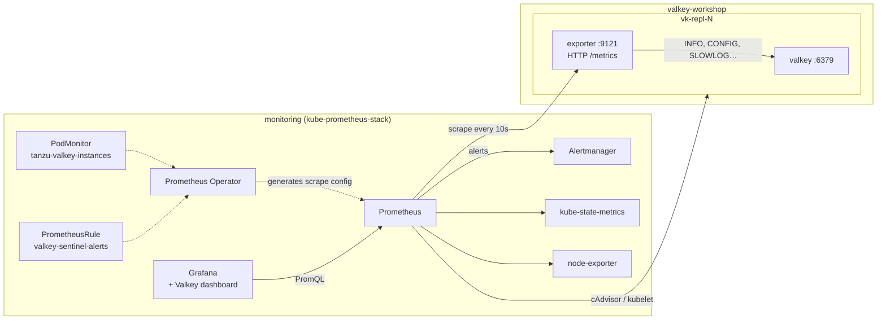

# Module 7: Metrics with Prometheus and Grafana

[← Module 6](06-tools-cli-and-web-consoles.md) | [README](../README.md) | Next: [Module 8: Logs →](08-logs.md)

**Goal:** deploy an all-in-one Prometheus stack, enable the Tanzu Valkey exporter, scrape it with a PodMonitor, load a Valkey Sentinel dashboard and alert rules, and learn to interpret the metrics an operator cares about: CPU, memory, fragmentation, cache hit rate, network, connections, replication and persistence.

📘 **Docs:** [Monitor instances](https://techdocs.broadcom.com/us/en/vmware-tanzu/data-solutions/tanzu-for-valkey-on-kubernetes/3-5/valkey-on-kubernetes/monitoring.html) · [Property reference: valkeyExporter](https://techdocs.broadcom.com/us/en/vmware-tanzu/data-solutions/tanzu-for-valkey-on-kubernetes/3-5/valkey-on-kubernetes/property-reference-valkey.html) · [Enable metrics (Tanzu Valkey 9.1)](https://techdocs.broadcom.com/us/en/vmware-tanzu/data-solutions/tanzu-valkey/9-1/tanzu-valkey-docs/enable-metrics.html) · [kube-prometheus-stack chart](https://github.com/prometheus-community/helm-charts/tree/main/charts/kube-prometheus-stack)

---

## 7.1 Architecture



Two complementary metric sources:

| Source | Examples | Answers |
|--------|----------|---------|
| **Valkey exporter** (inside each pod) | memory used, fragmentation, hits/misses, ops/s, replication offsets, role | what Valkey thinks |
| **Kubernetes** (cAdvisor, kube-state-metrics) | container CPU/memory vs limits, throttling, restarts, OOMKills, PVC usage | what the platform sees |

## 7.2 Install kube-prometheus-stack ("Prometheus all-in-one")

The chart installs the Prometheus Operator, Prometheus, Alertmanager, Grafana, kube-state-metrics and node-exporter in one step. Review [`kube-prometheus-stack-values.yaml`](../manifests/07-monitoring/kube-prometheus-stack-values.yaml). The important settings are:

- `*SelectorNilUsesHelmValues: false`: Prometheus picks up PodMonitors and PrometheusRules from **any** namespace, not only those labelled with the Helm release.
- the Grafana dashboard **sidecar**: any ConfigMap labelled `grafana_dashboard: "1"` becomes a dashboard.
- `prometheus-node-exporter.hostRootFsMount.enabled: false`: required on VKS and other restricted clusters.

```bash
source ./env.sh
kubectl create namespace "${MONITORING_NS}" --dry-run=client -o yaml | kubectl apply -f -
# node-exporter needs host access: allow it in this namespace only (VKS / PSA clusters)
kubectl label ns "${MONITORING_NS}" pod-security.kubernetes.io/enforce=privileged --overwrite

# Chart repository (also in module 1.6; safe to re-run)
helm repo add prometheus-community https://prometheus-community.github.io/helm-charts --force-update
helm repo update prometheus-community

helm upgrade --install kps prometheus-community/kube-prometheus-stack \
  -n "${MONITORING_NS}" \
  -f manifests/07-monitoring/kube-prometheus-stack-values.yaml \
  --set grafana.adminPassword="${GRAFANA_ADMIN_PASSWORD}" \
  --set grafana.service.type="${MONITORING_SERVICE_TYPE}" \
  --set prometheus.service.type="${MONITORING_SERVICE_TYPE}" \
  --wait --timeout 10m

kubectl get pods,svc -n "${MONITORING_NS}"
```

🔎 **Check:** pods for `kps-operator`, `prometheus-kps-prometheus-0`, `alertmanager-kps-alertmanager-0`, `kps-grafana-*`, `kps-kube-state-metrics-*` and one `node-exporter` per node are Running.

## 7.3 Enable the Valkey exporter

The exporter is a sidecar that queries Valkey (`INFO` and friends) and serves Prometheus metrics on **port 9121** at `/metrics`.

> ⚠️ The Broadcom monitoring page describes an **HTTPS** endpoint and a PodMonitor with `scheme: https`. On operator 3.5.1 (instance without TLS) the exporter serves **plain HTTP**: `curl https://…:9121` gets no response, `curl http://…:9121` returns the metrics. The workshop uses `http` throughout. If you enable instance TLS (module 5.8), check again.

```bash
kubectl explain valkeysentinel.spec.valkeyReplicationConfig.valkeyExporter   # confirm the field for your version
patch-sentinel.sh manifests/07-monitoring/01-exporter-patch.yaml
kubectl get pods -n "${VALKEY_NS}" -w                     # rolling restart of the data pods
```

> The exporter switch goes under `spec.valkeyReplicationConfig.valkeyExporter`; the top-level `spec.valkeyExporter` still works on 3.5.1 but the operator warns that it's deprecated. Exporter CPU/memory stay at `spec.resources.exporter`. The patch also prints the usual `valkeySecret and spec.acl are both set` warning (harmless, module 6.7).

⚠️ This restarts the data pods, including the primary, so expect a failover. In production, enable the exporter when you create the instance.

Verify a container port named `metrics` exists and the endpoint answers:

```bash
P=$(repl_pods | head -1)
kubectl get pod "$P" -n "${VALKEY_NS}" -o jsonpath='{range .spec.containers[*]}{.name}{" ports="}{.ports[*].name}{"/"}{.ports[*].containerPort}{"\n"}{end}'

kubectl port-forward -n "${VALKEY_NS}" "pod/$P" 9121:9121 &
sleep 2; curl -s http://localhost:9121/metrics | head -20
```

### Discover the metric names

The exporter is based on the upstream `redis_exporter`, and the Broadcom docs don't state the metric prefix. The Tanzu Valkey 3.5.1 exporter (v1.82.0) uses **`redis_…`** (`redis_up`, `redis_instance_info`, …), and the workshop's alert rules and dashboard default to it. Check yours:

```bash
curl -s http://localhost:9121/metrics | grep -E '^(valkey|redis)_' | sed 's/[{ ].*//' | sort -u | head -80
kill %1
```

- If the names start with **`redis_`**, you're done.
- If they start with **`valkey_`** (other exporter builds), run `switch-metric-prefix.sh valkey` and pick **Metric prefix** = `valkey` in the Grafana dashboard.

## 7.4 Scrape with a PodMonitor

[`02-podmonitor.yaml`](../manifests/07-monitoring/02-podmonitor.yaml) is based on the PodMonitor in the Broadcom monitoring docs (10 s interval), but uses `scheme: http` because the 3.5.1 exporter serves plain HTTP (the docs show `https` with `insecureSkipVerify`). It's also generalised to select every pod with a `metrics` port in the Valkey namespaces, and it adds a `node` label so dashboards can show placement.

```bash
kubectl get crd podmonitors.monitoring.coreos.com
render manifests/07-monitoring/02-podmonitor.yaml | kubectl apply -f -
```

Open Prometheus and check the targets:

```bash
kubectl port-forward -n "${MONITORING_NS}" svc/kps-prometheus 9090:9090
# http://localhost:9090/targets  ->  podMonitor/monitoring/tanzu-valkey-instances/0  (3/3 up)
```

🔎 **Check:** in the Prometheus UI, query `redis_up`: three series with value `1`.

Not up? Run through this list:

| Symptom | Fix |
|---------|-----|
| No target at all | port name isn't `metrics` (check 7.3), or the namespace isn't in `namespaceSelector` |
| Target down: `connection refused` / timeout | NetworkPolicy blocks 9121 from `monitoring` (module 5 policy allows it) |
| Target down: `server gave HTTP response to HTTPS client` (or HTTP 400) | scheme mismatch: the 3.5.1 exporter is plain HTTP, so use `scheme: http` (no `tlsConfig`) |
| `*_up == 0` | exporter can't authenticate to Valkey (exporter logs: `NOAUTH`, `WRONGPASS`, protected mode) |

## 7.5 Load the Grafana dashboard

```bash
kubectl create configmap valkey-dashboards -n "${MONITORING_NS}" \
  --from-file=monitoring/dashboards/ --dry-run=client -o yaml \
| kubectl label --local -f - grafana_dashboard=1 -o yaml \
| kubectl annotate --local -f - grafana_folder=Valkey -o yaml \
| kubectl apply -f -

kubectl port-forward -n "${MONITORING_NS}" svc/kps-grafana 3000:80
# http://localhost:3000   user: admin   password: $(cat .secrets/grafana)
```

Open **Dashboards → Valkey → Tanzu Valkey - Sentinel HA Overview**. Select your namespace. **Metric prefix** defaults to `redis`; switch to `valkey` only if your exporter uses that prefix.

Start load in another terminal so the graphs come alive:

```bash
kubectl exec -it -n "${VALKEY_NS}" valkey-client -- /scripts/load.sh
```

| Row | Panels | Use it to answer |
|-----|--------|------------------|
| Overview & topology | pods up, **current primary**, replicas attached, ops/s, hit rate, clients, keys, **role & placement table**, **primary over time** | Is it healthy? Who is the writer, on which node? When was the last failover? |
| CPU | Valkey process CPU, container CPU vs limit, throttling | Is the main thread saturated? Are we CPU-throttled? |
| Memory & fragmentation | used vs maxmemory vs RSS, fragmentation ratio, container memory vs limit, evictions/expirations, memory by role | Will we OOM? Are we evicting? Is memory wasted? |
| Cache efficiency & keyspace | hit rate by pod, hits/misses, keys per DB | Is the cache effective? |
| Network & connections | in/out throughput, connected/blocked clients vs maxclients, new/rejected connections | Network saturation? Connection leaks? Missing pooling? |
| Replication | offset lag in bytes, replica lag (s), link status | Are replicas current, so a failover would lose little? |
| Persistence | changes since last save, time since last save, bgsave status | Is data being persisted? |
| Commands & latency | top commands, average µs per command, slowlog length | What is the workload? Which commands are slow? |

The dashboard also shows an **annotation (red marker) every time the primary changes**. Watch for it in module 9.

**Optional community dashboards:** Grafana.com dashboards **763** and **11835** ("Redis Dashboard for Prometheus Redis Exporter") work with exporters that use the `redis_` prefix. Import them under *Dashboards → New → Import*.

## 7.6 The key metrics: what they mean and when to worry

The queries use the `redis_` prefix of the 3.5.1 exporter. Replace it with `valkey_` if your exporter uses that prefix.

### CPU utilization

| PromQL | Meaning | Worry when |
|--------|---------|------------|
| `rate(redis_cpu_sys_seconds_total[5m]) + rate(redis_cpu_user_seconds_total[5m])` | cores used by the Valkey process | approaching **1.0**: the main thread is saturated, whatever the pod's CPU limit |
| `rate(container_cpu_cfs_throttled_periods_total[5m]) / rate(container_cpu_cfs_periods_total[5m])` | share of time throttled by the CPU limit | > 10–20 % sustained adds latency |

🧠 A spike in **sys** CPU on the primary with a matching memory spike usually means a `BGSAVE` fork (RDB snapshot or a full resync for a replica).

### Memory usage and fragmentation

| PromQL | Meaning | Worry when |
|--------|---------|------------|
| `redis_memory_used_bytes` | memory allocated by Valkey (data + overhead) | trending toward `maxmemory` or the container limit |
| `redis_memory_max_bytes` | `maxmemory` (0 = unlimited) | 0 in production (no protection from OOMKill) |
| `redis_memory_used_bytes / redis_memory_max_bytes` | utilisation | > 90 % |
| `redis_memory_used_rss_bytes` | resident memory as the OS sees it | close to the container memory limit |
| `redis_mem_fragmentation_ratio` | RSS / used | **> 1.5** = fragmented (wasted RAM), **< 1.0** = swapping (severe) |
| `container_memory_working_set_bytes / kube_pod_container_resource_limits{resource="memory"}` | pod memory vs limit | > 90 % → OOMKill risk |
| `rate(redis_evicted_keys_total[5m])` | keys evicted due to maxmemory | > 0 unexpectedly (data loss for non-cache workloads) |

🧠 Fragmentation is noisy on near-empty instances (a few MB). Only act when the dataset is substantial. Remedies: `CONFIG SET activedefrag yes`, or a rolling restart (replicas first, then a failover).

### Cache hit rate

```promql
sum(rate(redis_keyspace_hits_total[5m]))
/
(sum(rate(redis_keyspace_hits_total[5m])) + sum(rate(redis_keyspace_misses_total[5m])))
```

What counts as "good" depends on the application: often > 90 % for caches. A sudden drop after a deploy, an eviction storm or a failover is the signal to look for.

### Network

| PromQL | Meaning |
|--------|---------|
| `rate(redis_net_input_bytes_total[5m])` | bytes received (client writes and commands) |
| `rate(redis_net_output_bytes_total[5m])` | bytes sent (replies **plus** the replication stream to each replica) |
| `rate(container_network_transmit_bytes_total{namespace="valkey-workshop"}[5m])` | pod network as Kubernetes sees it |

### Connections

| PromQL | Meaning | Worry when |
|--------|---------|------------|
| `redis_connected_clients` | open client connections | approaching `redis_config_maxclients` |
| `redis_blocked_clients` | clients in blocking calls (`BLPOP`, …) | unexpected growth |
| `rate(redis_connections_received_total[5m])` | new connections/s | high = clients not pooling |
| `increase(redis_rejected_connections_total[5m])` | refused because of maxclients | **any** |

### Replication (HA health)

| PromQL | Meaning |
|--------|---------|
| `redis_instance_info{role="master"}` | which pod is the primary (exactly one) |
| `redis_connected_slaves` | replicas attached to the primary (expect 2) |
| `redis_master_link_up` | on replicas: link to the primary up (1) |
| `redis_connected_slave_lag_seconds` | per-replica lag seen by the primary |
| `scalar(max(redis_master_repl_offset)) - redis_master_repl_offset` | lag in bytes per pod |

### Persistence

| PromQL | Meaning |
|--------|---------|
| `redis_rdb_last_bgsave_status` | 1 = last snapshot succeeded |
| `time() - redis_rdb_last_save_timestamp_seconds` | seconds since the last successful save |
| `redis_rdb_changes_since_last_save` | writes at risk if the node restarts now |
| `kubelet_volume_stats_used_bytes / kubelet_volume_stats_capacity_bytes` | PVC fill level (when the CSI driver exposes volume stats) |

## 7.7 Alert rules

[`03-prometheusrule.yaml`](../manifests/07-monitoring/03-prometheusrule.yaml) implements the alerts an on-call operator needs:

| Group | Alerts |
|-------|--------|
| availability | `ValkeyInstanceDown`, `ValkeyExporterTargetMissing`, **`ValkeyNoPrimary`**, **`ValkeyMultiplePrimaries`** (split brain), `ValkeyFailoverOccurred` (info), `ValkeyPodRestarting` |
| replication | `ValkeyReplicaLinkDown`, `ValkeyReplicationLagHigh`, `ValkeyTooFewReplicas` |
| resources | `ValkeyMemoryNearMaxmemory`, `ValkeyMemoryNearContainerLimit`, `ValkeyHighFragmentation`, `ValkeyEvictingKeys`, `ValkeyConnectionsHigh`, `ValkeyRejectedConnections` |
| persistence | `ValkeyRdbSaveFailed` |

```bash
render manifests/07-monitoring/03-prometheusrule.yaml | kubectl apply -f -
# Prometheus UI -> Alerts (http://localhost:9090/alerts): the valkey.* groups are listed, all green
```

🧠 Route `critical` alerts to your paging tool and `warning`/`info` to chat by configuring **Alertmanager** receivers (`alertmanager.config` in the chart values). `ValkeyFailoverOccurred` deliberately has severity `info`: a failover that Sentinel handled is good news, but someone should still find out *why* it happened.

## 7.8 Exercises

1. With `load.sh` running, find on the dashboard: the current primary and its node, the ops/s, and the CPU of the primary vs the replicas. Why is the primary's network **output** higher than its input?
2. Run a GET-heavy load against a mostly empty keyspace and watch the hit rate fall:
   ```bash
   kubectl exec -n "$VALKEY_NS" valkey-client -- env TESTS=get KEYSPACE=5000000 REQUESTS=300000 /scripts/load.sh
   ```
3. Check `maxmemory` on the primary (`vcli "$(primary_pod)" CONFIG GET maxmemory`). Compare **memory used** with the **container limit** panel. How much headroom do you have before an OOMKill?
4. Take a snapshot (`vcli "$(primary_pod)" BGSAVE`) and watch the **Seconds since last successful save** panel reset. Then look for a CPU blip on the primary.
5. Open Valkey Admin side by side and compare what it shows with Grafana. Which would you hand to an application team, and which to on-call?

---

[← Module 6](06-tools-cli-and-web-consoles.md) | [README](../README.md) | Next: [Module 8: Logs →](08-logs.md)
