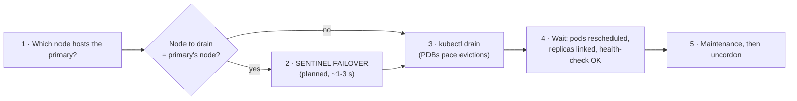

# Module 9: Failover of the writer

[← Module 8](08-logs.md) | [README](../README.md) | Next: [Module 10: Backup, restore and DR →](10-backup-restore-dr.md)

**Goal:** perform and observe **planned** and **unplanned** failovers of the primary, measure their impact on a Sentinel-aware client, and learn the safe procedure for node maintenance.

📘 **Docs:** [Access instances (Sentinel commands)](https://techdocs.broadcom.com/us/en/vmware-tanzu/data-solutions/tanzu-for-valkey-on-kubernetes/3-5/valkey-on-kubernetes/accessing.html) · [Troubleshooting](https://techdocs.broadcom.com/us/en/vmware-tanzu/data-solutions/tanzu-for-valkey-on-kubernetes/3-5/valkey-on-kubernetes/troubleshooting.html) · [Sentinel: failover](https://valkey.io/topics/sentinel/)

---

## 9.1 Set up your observation deck

Use four terminals (all with `source ./env.sh`) plus a browser:

| Terminal | Command | Shows |
|----------|---------|-------|
| **A: client** | `kubectl exec -it -n $VALKEY_NS valkey-client -- /scripts/write-loop.sh` | Sentinel-aware writes every 0.5 s; which primary; errors |
| **B: Sentinel log** | `kubectl logs -n $VALKEY_NS -f "$(sentinel_pod)"` | `+sdown`, `+odown`, `+switch-master`, … |
| **C: pods** | `kubectl get pods -n $VALKEY_NS -o wide -w` | restarts, rescheduling |
| **D: commands** | your working terminal | |
| **Browser** | Grafana → *Tanzu Valkey - Sentinel HA Overview* | primary-over-time timeline, failover annotations, replication lag |

Take a baseline in terminal D:

```bash
topology.sh
scli SENTINEL master "${MASTER_GROUP}" | paste - - | grep -E 'config-epoch|num-slaves|flags'
health-check.sh
```

Write down: **primary pod**, **node**, **config-epoch**.

> If you enabled Sentinel auth in module 5, the client pod must know about it. Recreate it with `SENTINEL_AUTH=true` exported:
> `client_env && kubectl delete pod valkey-client -n $VALKEY_NS && render manifests/06-tools/02-valkey-client-pod.yaml | kubectl apply -f -`

## 9.2 Lab 1: planned (manual) failover

`SENTINEL FAILOVER` forces a failover **without** waiting for failure detection or asking the other Sentinels to agree. Use it for maintenance, to move the writer off a node, or to test client behaviour.

```bash
scli SENTINEL FAILOVER "${MASTER_GROUP}"
# OK
```

Observe:

- **Terminal A:** a few writes fail or stall for about 1–3 s, then continue against a **new primary address**.
- **Terminal B:** `+new-epoch`, `+try-failover`, `+selected-slave`, `+promoted-slave`, `+failover-state-reconf-slaves`, **`+switch-master`**, `+failover-end`.
- **Grafana:** a red *Failover* annotation; the *Primary over time* timeline switches colour.

Verify:

```bash
topology.sh
scli SENTINEL master "${MASTER_GROUP}" | paste - - | grep config-epoch    # incremented
```

🔎 **Check:** a different pod is `PRIMARY`; the old primary is now a `replica` with `LINK up`; `config-epoch` went up by 1.

### Choosing which replica gets promoted

Sentinel picks the replica with the **lowest non-zero `replica-priority`**, then the **largest replication offset**. Steer a planned failover toward a specific pod (for example one in the preferred zone):

```bash
target=$(replica_pods | head -1); other=$(replica_pods | tail -1)
vcli "$target" CONFIG SET replica-priority 10
vcli "$other"  CONFIG SET replica-priority 100
scli SENTINEL FAILOVER "${MASTER_GROUP}"; sleep 8; primary_pod    # -> $target
# reset
for p in $(repl_pods); do vcli "$p" CONFIG SET replica-priority 100 >/dev/null; done
```

> `replica-priority 0` means *never promote this replica* (for example a reporting replica in a far zone). Runtime `CONFIG SET` values don't survive a pod restart, so make permanent placement decisions part of the instance design.

## 9.3 Lab 2: unplanned: the primary pod disappears

Simulate the loss of the primary pod (process crash, eviction, node failure):

```bash
victim=$(primary_pod); echo "deleting primary $victim at $(date +%T)"
kubectl delete pod -n "${VALKEY_NS}" "$victim" --wait=false
```

Observe the timeline:

| Time | What happens | Where you see it |
|------|--------------|------------------|
| t+0 | pod terminating; writes fail | A: `ERROR` / `NO PRIMARY` |
| t+~5 s | `downAfterMilliseconds` (5000) expires → `+sdown`, `+odown` | B |
| t+~6 s | leader elected, replica promoted, `+switch-master` | B, A switches primary |
| t+10–40 s | StatefulSet recreates `$victim`; it starts, loads its RDB, and is turned into a **replica** (`+convert-to-slave`) | C, B |

```bash
topology.sh
```

🔎 **Check:** count the failed writes in terminal A. Roughly `downAfterMilliseconds` + 1–2 s of write unavailability. With the operator default of 30000 ms it would have been about 30 s. That's the HA trade-off you tune with `downAfterMilliseconds`.

## 9.4 Lab 3: unplanned: the primary hangs (but does not die)

A hung process (stuck disk, a long-running command, a paused VM) is worse than a crash: the pod stays `Running`, so Kubernetes does nothing. Only Sentinel notices. Simulate it by pausing all clients on the primary for 20 s:

```bash
hung=$(primary_pod); echo "pausing $hung"
vcli "$hung" CLIENT PAUSE 20000 ALL
```

Observe:

- **Terminal C:** nothing happens. The pod stays `Running`/`Ready` (or briefly NotReady when probes time out).
- **Terminal B:** Sentinels' PINGs go unanswered → `+sdown` → `+odown` → failover to a replica.
- **Terminal A:** the write in flight **blocks** until the client times out (valkey-cli has no short default timeout), then writes resume on the new primary.
- After 20 s the old primary unpauses, receives Sentinel's `REPLICAOF` and becomes a replica (`+convert-to-slave`).

🧠 **Operator insight:** this is why application clients need **short command timeouts** (1–2 s). A client with a 60 s timeout would hang on the frozen primary long after Sentinel has failed over.

## 9.5 Lab 4: node maintenance (drain) done right

Draining a node that hosts the primary evicts it. PodDisruptionBudgets limit how many Valkey and Sentinel pods may be evicted at once.

Look at the PDBs first:

```bash
kubectl get pdb -n "${VALKEY_NS}"
# NAME …  MIN AVAILABLE  MAX UNAVAILABLE  ALLOWED DISRUPTIONS
```

**Safe procedure: move the writer away first, then drain.**



```bash
NODE=$(kubectl get pod "$(primary_pod)" -n "${VALKEY_NS}" -o jsonpath='{.spec.nodeName}'); echo "$NODE"

# 2. planned failover so the drain doesn't cause an unplanned one
scli SENTINEL FAILOVER "${MASTER_GROUP}"; sleep 10; topology.sh

# 3. drain (the node may also host a Sentinel and other workloads)
kubectl drain "$NODE" --ignore-daemonsets --delete-emptydir-data --timeout=5m

# 4. verify
kubectl get pods -n "${VALKEY_NS}" -o wide
health-check.sh

# 5. bring the node back
kubectl uncordon "$NODE"
```

🔎 **Check:** the evicted pods reschedule on other nodes (with *preferred* anti-affinity they may now share a node, so check the placement warning in `topology.sh`). Data pods with PVCs can only move to nodes that can attach their volume (same zone for zonal storage). A data pod stuck `Pending` after a drain is usually a **volume topology** constraint.

> **VKS node upgrades:** when you upgrade a VKS cluster (a new Kubernetes release), Cluster API replaces worker nodes one by one and drains each node, **honouring PDBs**. Expect one or more automatic failovers during a cluster upgrade. Run `health-check.sh` before you start, keep `write-loop.sh` or your dashboards open, and make sure no PDB is permanently blocking (`ALLOWED DISRUPTIONS = 0` for a long time stalls the upgrade).

## 9.6 Post-failover checklist

After **any** failover, planned or not:

- [ ] Exactly **one** primary (`topology.sh`, Grafana *Current primary*)
- [ ] All replicas `master_link_status:up`, lag ≈ 0
- [ ] `SENTINEL ckquorum` → OK, and all Sentinels agree on the primary
- [ ] `config-epoch` incremented exactly as expected (no failover ping-pong)
- [ ] Clients reconnected (connected clients back to normal; no error spike in apps)
- [ ] No full resync loop (`master_sync_in_progress:0`; no repeated "Full resync" in logs)
- [ ] Root cause identified for unplanned failovers (logs, events, node conditions)
- [ ] `ValkeyFailoverOccurred` alert seen and acknowledged

## 9.7 Did we lose writes?

Stop the write loop (Ctrl-C in terminal A). It prints:

```
acknowledged=812 failed=17 last_value=812
```

Compare with the server:

```bash
vcli "$(primary_pod)" GET app:failover:counter
```

- Server value **≥** `last_value` → no acknowledged write was lost.
- Server value **<** `last_value` → acknowledged writes were lost to **asynchronous replication**. The primary acked them and then died before they reached the promoted replica.

🧠 **Reducing the loss window.** Valkey offers `min-replicas-to-write N` / `min-replicas-max-lag S`: the primary refuses writes unless N replicas are connected with lag ≤ S. This limits loss during network partitions (an isolated old primary stops accepting writes), at the cost of failing writes when replicas are unavailable. It's a design decision for the application owner. Document your chosen RPO.

## 9.8 What NOT to do on a Sentinel-managed deployment

| Don't | Why |
|-------|-----|
| Run `REPLICAOF host port` / `REPLICAOF NO ONE` by hand | Sentinel and the operator manage roles; manual changes fight them and can cause split brain |
| `SENTINEL REMOVE` / `SENTINEL MONITOR` / `SENTINEL SET` | the operator owns the Sentinel configuration; change the CR instead |
| `SENTINEL RESET valkey-server` casually | forgets replicas/Sentinels until rediscovered; use only when instructed (for example after permanently removing a node) |
| Fail over while a replica is in a full resync | the candidate may be far behind; check `master_sync_in_progress` and lag first |
| `kubectl delete pod --force --grace-period=0` on data pods | can produce two pods with the same identity on different nodes in a partition |
| Lower `downAfterMilliseconds` to ~1000 in production | false failovers during GC pauses, forks and network blips |

---

[← Module 8](08-logs.md) | [README](../README.md) | Next: [Module 10: Backup, restore and DR →](10-backup-restore-dr.md)
