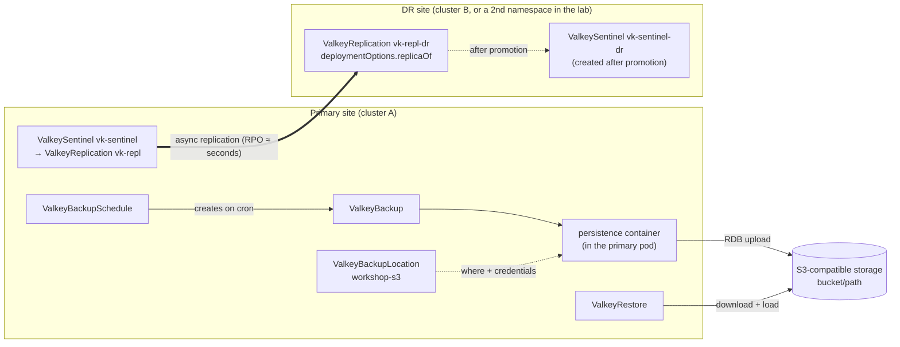
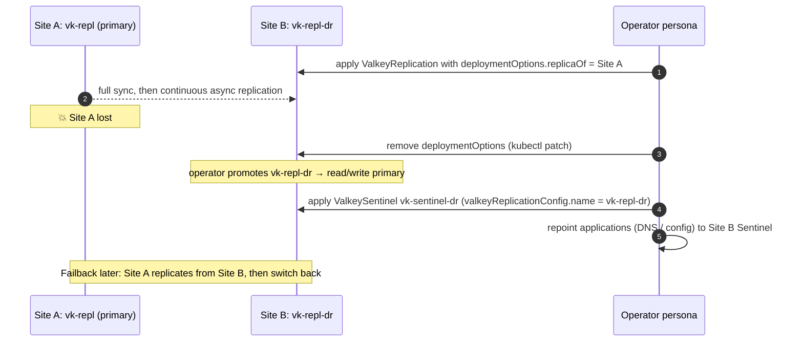

# Module 10: Backup, restore and disaster recovery

[← Module 9](09-failover.md) | [README](../README.md) | Next: [Module 11: Patching and upgrades →](11-patching-and-upgrades.md)

**Goal:** configure an S3 backup location, take on-demand and scheduled backups of the Sentinel deployment, restore them into a new instance, and replicate to a DR site (another cluster or namespace), including promoting the DR site.

📘 **Docs:** [Back up an instance](https://techdocs.broadcom.com/us/en/vmware-tanzu/data-solutions/tanzu-for-valkey-on-kubernetes/3-5/valkey-on-kubernetes/backup.html) · [Restore a backup](https://techdocs.broadcom.com/us/en/vmware-tanzu/data-solutions/tanzu-for-valkey-on-kubernetes/3-5/valkey-on-kubernetes/restore.html) · [Configure disaster recovery](https://techdocs.broadcom.com/us/en/vmware-tanzu/data-solutions/tanzu-for-valkey-on-kubernetes/3-5/valkey-on-kubernetes/disaster-recovery-workflow.html) · [Enable persistence](https://techdocs.broadcom.com/us/en/vmware-tanzu/data-solutions/tanzu-for-valkey-on-kubernetes/3-5/valkey-on-kubernetes/persistence.html)

---

## 10.1 Concepts



| Custom resource | Purpose |
|-----------------|---------|
| `ValkeyBackupLocation` | S3 bucket, path, endpoint, region, credentials secret, optional `backupSync` |
| `ValkeyBackup` | one backup of an instance. **For Sentinel, reference the `ValkeyReplication` name** (`vk-repl`) |
| `ValkeyBackupSchedule` | cron schedule that creates `ValkeyBackup` objects |
| `ValkeyRestore` | restores a backup into a **new** instance (`Valkey`, `ValkeyReplication` or `ValkeySentinel`) in the same namespace |
| `deploymentOptions.replicaOf` | runs an instance as a replica of a remote primary (DR) |

**Prerequisites and rules (Broadcom docs):**

- Persistence must be enabled on the instance (it is, from module 3).
- Storage must be S3-compatible (AWS S3, MinIO, ECS, StorageGRID, …).
- Use a **unique bucket or `bucketPath` per namespace**. Never share one across namespaces.
- The `ValkeyRestore` must be in the same namespace as the `ValkeyBackup` and `ValkeyBackupLocation`.
- Backups are managed with CRs and `kubectl`. The web consoles don't manage backup lifecycles.
- Retention is enforced by a CronJob the operator creates. It deletes expired backups from S3 and removes their `ValkeyBackup` objects.

### RPO / RTO cheat sheet

| Mechanism | RPO (data you can lose) | RTO (time to recover) | Protects against |
|-----------|-------------------------|-----------------------|------------------|
| Sentinel failover | ms of async replication | seconds | pod/node loss |
| Scheduled backup every *N* min | up to *N* min | minutes (restore + app reconfig) | logical errors, cluster loss |
| DR replica in a second cluster | seconds (replication lag) | minutes (promote + repoint apps) | site loss (**not** logical errors) |

## 10.2 Lab: deploy MinIO as the backup target (lab only)

```bash
source ./env.sh
render manifests/10-backup-dr/00-minio.yaml | kubectl apply -f -
kubectl -n "${MINIO_NS}" rollout status deploy/minio --timeout=180s
kubectl -n "${MINIO_NS}" wait --for=condition=complete job/minio-create-bucket --timeout=180s
kubectl -n "${MINIO_NS}" logs job/minio-create-bucket
```

🔎 **Check:** the job log lists the `valkey-backups/` bucket.

The Service type comes from `MINIO_SERVICE_TYPE` in `env.sh` (default `ClusterIP`). With `LoadBalancer`, wait for an external IP:

```bash
kubectl get svc minio -n "${MINIO_NS}"     # TYPE, EXTERNAL-IP, PORT(S) 9000 (S3 API) and 9001 (console)
```

The backup location (10.3) always uses the in-cluster address `minio.${MINIO_NS}.svc`, so backups work with either type. `LoadBalancer` only makes the console and S3 API reachable from outside the cluster, protected by the MinIO root password. Changed the value after deploying? `source ./env.sh` and re-run the `render … | kubectl apply` line above.

> ⚠️ Production backups must live **outside** the cluster and ideally outside the site. In-cluster MinIO only demonstrates the mechanics.

## 10.3 Lab: create the backup location

```bash
render manifests/10-backup-dr/01-backup-credentials-secret.yaml | kubectl apply -f -
kubectl explain valkeybackuplocation.spec.storage.s3          # confirm fields for your version
render manifests/10-backup-dr/02-backup-location.yaml | kubectl apply -f -
kubectl get valkeybackuplocation -n "${VALKEY_NS}"
kubectl get valkeybackuplocation workshop-s3 -n "${VALKEY_NS}" -o jsonpath='{.spec}{"\n"}{.status}{"\n"}'
```

## 10.4 Lab: on-demand backup

Seed some recognisable data first:

```bash
P=$(primary_pod)
vcli "$P" SET app:backup:marker "taken-at-$(date +%FT%T)"
kubectl exec -n "${VALKEY_NS}" valkey-client -- env TESTS=set REQUESTS=20000 KEYSPACE=20000 /scripts/load.sh
vcli "$P" DBSIZE
vcli "$P" GET app:backup:marker
```

For RDB persistence, the docs recommend saving right before the backup so the latest writes are included:

```bash
vcli "$P" SAVE          # blocks briefly; fine for small datasets. Use BGSAVE + LASTSAVE polling for large ones.
```

Trigger the backup and watch it:

```bash
render manifests/10-backup-dr/03-backup-ondemand.yaml | kubectl apply -f -
kubectl get valkeybackup -n "${VALKEY_NS}" -w          # Pending -> Running -> Succeeded
```

While it runs, follow the persistence container in the **primary** pod:

```bash
kubectl logs -n "${VALKEY_NS}" -f "$(primary_pod)" -c persistence
```

🔎 **Check:** status `Succeeded`. Confirm the object exists in S3:

```bash
# MinIO stores each object as a directory under /data/<bucket>/<object-path>/
kubectl exec -n "${MINIO_NS}" deploy/minio -- ls -R "/data/${BACKUP_BUCKET}" | head -30

# or browse the MinIO console: user valkey-backup, password $(cat .secrets/minio)
# MINIO_SERVICE_TYPE=ClusterIP:
kubectl port-forward -n "${MINIO_NS}" svc/minio 9001:9001   # http://localhost:9001
# MINIO_SERVICE_TYPE=LoadBalancer:
echo "http://$(kubectl get svc minio -n "${MINIO_NS}" -o jsonpath='{.status.loadBalancer.ingress[0].ip}'):9001"
```

Inspect the details:

```bash
kubectl describe valkeybackup "${REPL_NAME}-manual-01" -n "${VALKEY_NS}"
```

## 10.5 Lab: scheduled backups and retention

```bash
render manifests/10-backup-dr/04-backup-schedule.yaml | kubectl apply -f -
kubectl get valkeybackupschedule -n "${VALKEY_NS}"
kubectl get cronjobs -n "${VALKEY_NS}"                 # schedule and retention CronJobs
# after the next quarter hour:
kubectl get valkeybackup -n "${VALKEY_NS}" --sort-by=.metadata.creationTimestamp
```

🧠 **Production guidance:**

- Schedule according to the RPO you agreed with the application owner (for example every 1–6 hours), at low-traffic times. A backup forks and writes an RDB (CPU and memory copy-on-write).
- Monitor backup **success**, not just existence. Alert when the newest `Succeeded` backup is older than 2× the schedule interval. (Watch `ValkeyBackup` status, or query S3 object timestamps.)
- Encrypt the bucket (SSE), restrict the credentials to the bucket path, enable object versioning/immutability (ransomware protection), and replicate the bucket off-site.

## 10.6 Lab: restore into a new instance

Restores target a **new** instance in the same namespace. Restoring regularly into a throwaway instance is the only way to prove a backup works.

Simulate a disaster on the source, a human error that Sentinel can't protect against:

```bash
vcli "$(primary_pod)" DEL app:backup:marker
vcli "$(primary_pod)" GET app:backup:marker        # (nil), and the replicas lost it too!
```

Restore the backup into a standalone instance `vk-restored` (cheap verification):

```bash
render manifests/10-backup-dr/05-restore-acl-secret.yaml | kubectl apply -f -
render manifests/10-backup-dr/06-restore-standalone.yaml | kubectl apply -f -
kubectl get valkeyrestore -n "${VALKEY_NS}" -w     # CreatingInstance -> WaitingForPrimary -> Running -> Succeeded
```

| Restore status | Meaning |
|----------------|---------|
| `CreatingInstance` | the operator is provisioning the target instance |
| `WaitingForPrimary` | waiting for the target primary pod to be ready |
| `Running` | data being restored |
| `Succeeded` | restore complete |
| `Failed` | see `kubectl describe valkeyrestore` and the operator logs |

Verify the data:

```bash
kubectl get valkey vk-restored -n "${VALKEY_NS}"
vcli vk-restored-0 GET app:backup:marker      # the value from before the DEL
vcli vk-restored-0 DBSIZE
```

🔎 **Check:** the marker key is back, and `DBSIZE` matches what you recorded before the backup.

**Getting the data back into production.** Options, from least to most disruptive:

1. Copy the specific keys back (application-level script, or `DUMP`/`RESTORE` per key from `vk-restored` to the primary).
2. Point the application at a restored **`ValkeySentinel`** (see [`07-restore-sentinel.yaml`](../manifests/10-backup-dr/07-restore-sentinel.yaml), which needs 6 more pods) and retire the damaged one.

Clean up the restore target:

```bash
kubectl delete valkeyrestore restore-to-standalone -n "${VALKEY_NS}"
kubectl delete valkey vk-restored -n "${VALKEY_NS}"
kubectl delete pvc -n "${VALKEY_NS}" -l app=vk-restored 2>/dev/null   # if the PVC was kept
```

### Restoring in another cluster

Point a `ValkeyBackupLocation` in the target cluster at the same bucket/path with `spec.backupSync.enabled: true`. The operator then syncs the backups it finds in S3 into `ValkeyBackup` objects in that cluster, and you restore them with a `ValkeyRestore` as above. This is the backup-based DR path, with an RPO equal to the backup interval.

## 10.7 Lab: replication to a DR site (cross-cluster)

📘 [Configure disaster recovery](https://techdocs.broadcom.com/us/en/vmware-tanzu/data-solutions/tanzu-for-valkey-on-kubernetes/3-5/valkey-on-kubernetes/disaster-recovery-workflow.html)

| Source type | DR support (docs) |
|-------------|-------------------|
| `Valkey`, `ValkeyReplication` | full: `deploymentOptions.replicaOf` |
| **`ValkeySentinel`** | **limited: replicate into a `ValkeyReplication` at the DR site; after promotion, wrap it in a new `ValkeySentinel`** |



### Choose the source endpoint (`DR_SOURCE_HOST`)

The DR site needs an address for the source that it **can reach** and that keeps working across source failovers:

| Lab / environment | `DR_SOURCE_HOST` |
|-------------------|------------------|
| Single cluster (DR = 2nd namespace) | a source data pod FQDN, for example `vk-repl-0.vk-repl-headless.valkey-workshop.svc.cluster.local` |
| Two clusters | a DNS name or LoadBalancer reachable from cluster B. The release notes recommend *a DNS entry pointing to the primary* for cross-cluster Sentinel deployments |

🧠 Why a pod FQDN still works after a source failover: if `vk-repl-0` is demoted, it becomes a replica, and Valkey supports **chained replication**. The DR site keeps receiving data through it, with slightly more lag. For cross-cluster setups, keep that DNS record or LB pointing at a source node that is reliably up, ideally the current primary (updated from `+switch-master` events by automation).

### Build the DR site

```bash
# Lab: second namespace in the same cluster
export DR_SOURCE_HOST="${REPL_NAME}-0.${REPL_NAME}-headless.${VALKEY_NS}.svc.${CLUSTER_DOMAIN}"
DRK="kubectl"                                  # for 2 clusters: DRK="kubectl --context ${DR_CONTEXT}"

render manifests/10-backup-dr/10-dr-namespace-and-secrets.yaml | $DRK apply -f -
$DRK create secret docker-registry valkey-registry-secret -n "${DR_NS}" \
  --docker-server="https://${REGISTRY_SERVER}/" \
  --docker-username="${REGISTRY_USERNAME}" --docker-password="${REGISTRY_PASSWORD}" \
  --dry-run=client -o yaml | $DRK apply -f -

render manifests/10-backup-dr/11-dr-replication.yaml | $DRK apply -f -
$DRK get pods -n "${DR_NS}" -w
```

> Two clusters: the operator must be installed on cluster B too (module 2), and the source must accept connections from B. Allow cluster B's egress IPs in the module 5 NetworkPolicy if you applied it.

Verify replication:

```bash
VKNS=${DR_NS} vcli vk-repl-dr-0 INFO replication | grep -E 'role|master_host|master_link_status|master_last_io|slave_repl_offset'
vcli "$(primary_pod)" SET app:dr:probe "written-at-$(date +%T)"
sleep 2; VKNS=${DR_NS} vcli vk-repl-dr-0 GET app:dr:probe
echo "source keys: $(vcli "$(primary_pod)" DBSIZE)   dr keys: $(VKNS=${DR_NS} vcli vk-repl-dr-0 DBSIZE)"
```

🔎 **Check:** `role:slave`, `master_host` = your `DR_SOURCE_HOST`, `master_link_status:up`, and the probe key shows up at the DR site within a second or two. Grafana covers the DR namespace as well (choose it in the Namespace drop-down).

### Promote the DR site (simulated site loss)

```bash
# 1. "Lose" the source: in a drill, stop application writes to Site A (or block the network)
# 2. Remove replicaOf -> the operator promotes vk-repl-dr to primary
$DRK patch valkeyreplication vk-repl-dr -n "${DR_NS}" --type json \
  -p '[{"op":"remove","path":"/spec/deploymentOptions"}]'
sleep 15
VKNS=${DR_NS} vcli vk-repl-dr-0 ROLE | head -1                         # master
VKNS=${DR_NS} vcli vk-repl-dr-0 SET app:dr:after-promotion ok         # writes accepted

# 3. Restore automatic failover at the DR site
render manifests/10-backup-dr/12-dr-sentinel.yaml | $DRK apply -f -
$DRK get valkeysentinel,valkeyreplication,pods -n "${DR_NS}"
```

4. Repoint applications to the DR Sentinel (`vk-sentinel-dr-sentinel-headless.${DR_NS}.svc:26379`, master group `valkey-server`) through DNS, config or service bindings.

### Failback (overview)

1. When Site A is back, make it a replica of Site B: recreate it as a `ValkeyReplication` with `deploymentOptions.replicaOf` pointing at Site B, then wait for `master_link_status:up` and matching `DBSIZE`.
2. In a maintenance window, stop writes, remove `replicaOf` on Site A (promote), wrap it with its `ValkeySentinel` again, and repoint the applications.
3. Rebuild Site B as the DR replica of Site A.

⚠️ **DR caveats:**

- DR replication is **asynchronous**: you lose whatever hadn't replicated at the moment of disaster.
- It replicates **everything, including mistakes** (`DEL`, `FLUSHALL`). Keep backups as well.
- Never promote the DR site while the source is still accepting writes from applications. That's a self-inflicted split brain.
- Rehearse the runbook (DR drill) at least twice a year and measure your real RTO.

### Clean up the DR lab

```bash
$DRK delete valkeysentinel vk-sentinel-dr -n "${DR_NS}" --ignore-not-found
$DRK delete valkeyreplication vk-repl-dr -n "${DR_NS}" --ignore-not-found
$DRK delete ns "${DR_NS}"
```

---

[← Module 9](09-failover.md) | [README](../README.md) | Next: [Module 11: Patching and upgrades →](11-patching-and-upgrades.md)
