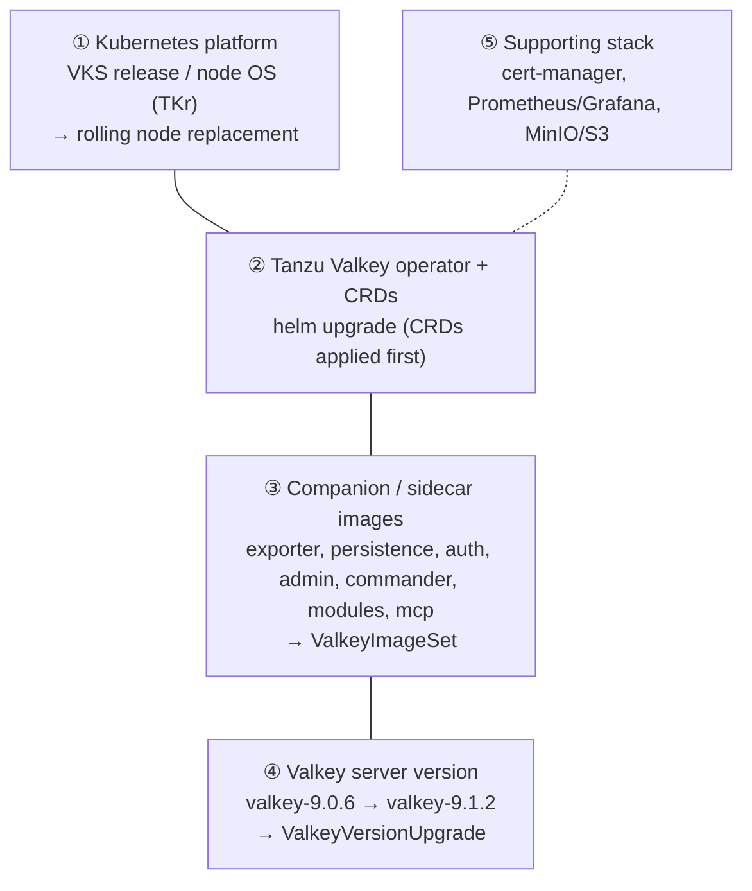
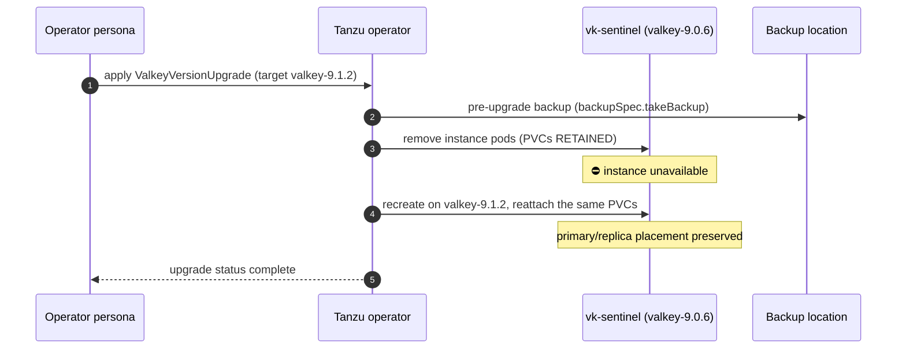

# Module 11: Patching and upgrades

[← Module 10](10-backup-restore-dr.md) | [README](../README.md) | Next: [Module 12: Troubleshooting runbook →](12-troubleshooting-runbook.md)

**Goal:** understand every layer that needs patching, follow a safe maintenance procedure, upgrade the operator, patch sidecar images with `ValkeyImageSet`, upgrade the Valkey version with `ValkeyVersionUpgrade`, and survive Kubernetes node upgrades on VKS.

📘 **Docs:** [Operator upgrade](https://techdocs.broadcom.com/us/en/vmware-tanzu/data-solutions/tanzu-for-valkey-on-kubernetes/3-5/valkey-on-kubernetes/upgrade-operator.html) · [Valkey version upgrade](https://techdocs.broadcom.com/us/en/vmware-tanzu/data-solutions/tanzu-for-valkey-on-kubernetes/3-5/valkey-on-kubernetes/version-upgrade.html) · [Release notes](https://techdocs.broadcom.com/us/en/vmware-tanzu/data-solutions/tanzu-for-valkey-on-kubernetes/3-5/valkey-on-kubernetes/release-notes.html) · [Property reference: ValkeyImageSet / ValkeyVersionUpgrade](https://techdocs.broadcom.com/us/en/vmware-tanzu/data-solutions/tanzu-for-valkey-on-kubernetes/3-5/valkey-on-kubernetes/property-reference-valkey.html)

---

## 11.1 The layers you patch



| Layer | How it is delivered | Disruption to a Sentinel instance |
|-------|---------------------|-----------------------------------|
| ① Nodes | VKS cluster upgrade (Cluster API) | rolling drains → one or more automatic failovers (PDB-paced) |
| ② Operator | new chart version | operator pod restart; supported instances may get updated images → rolling restarts |
| ③ Sidecars | `ValkeyImageSet` (usually updated by the operator upgrade) | rolling restart of affected pods |
| ④ Valkey version | `ValkeyVersionUpgrade` CR | **instance is unavailable during the upgrade** (recreated on retained PVCs) |
| CR edits (resources, probes, TLS, …) | `kubectl apply` / patch of the CR | rolling restart → possible failover |

**Sources of truth for what to patch:** the Tanzu for Valkey on Kubernetes [release notes](https://techdocs.broadcom.com/us/en/vmware-tanzu/data-solutions/tanzu-for-valkey-on-kubernetes/3-5/valkey-on-kubernetes/release-notes.html) (CVE fixes, component versions, supported Valkey versions, breaking changes) and the Broadcom Support Portal notifications. For example, 3.5.1 shipped new Valkey versions (8.0.11, 8.1.10, 9.0.6, 9.1.2), updated Valkey Admin/Persistence/Auth/Exporter images and security fixes.

## 11.2 Standard maintenance procedure

Use this for every layer:

1. **Read the release notes**: breaking changes, removed fields, supported versions, known issues.
2. **Upgrade a non-production environment first.** Run your application smoke tests.
3. **Health check:**
   ```bash
   source ./env.sh && health-check.sh && topology.sh
   ```
4. **Persist runtime configuration:** changes made with `CONFIG SET` are lost when pods are recreated. Either move them into the CR, or at least:
   ```bash
   for p in $(repl_pods); do vcli "$p" CONFIG REWRITE; done
   ```
5. **Take a fresh backup** and confirm `Succeeded` (module 10).
6. **Announce the window.** Open the Grafana dashboard, the Sentinel log and a write loop.
7. **Perform the change**, one layer at a time.
8. **Verify:** `health-check.sh`, versions, dashboards, alerts, application smoke test.
9. **Document** the versions before and after, the issues hit and the timings.

## 11.3 Upgrade the operator

Procedure from the Broadcom docs: **apply the new CRDs first, then `helm upgrade`.**

```bash
NEW_VERSION=3.5.1            # target chart version from the release notes

# 0. Where are we?
helm list -n "${OPERATOR_NS}"
helm history "${OPERATOR_RELEASE}" -n "${OPERATOR_NS}"
kubectl get deploy -n "${OPERATOR_NS}" -o wide

# 1. Pull the chart
rm -rf /tmp/tanzu-valkey-helm
helm pull oci://${REGISTRY_SERVER}/tanzu-valkey-helm --version "${NEW_VERSION}" --untar --untardir /tmp

# 2. Review what changes (CRDs and values)
kubectl diff -f /tmp/tanzu-valkey-helm/crds/ | head -50
diff <(helm get values "${OPERATOR_RELEASE}" -n "${OPERATOR_NS}" -o yaml) manifests/02-operator/operator-values.yaml

# 3. Apply CRDs (helm upgrade does not upgrade CRDs)
kubectl apply -f /tmp/tanzu-valkey-helm/crds/

# 4. Upgrade the operator, passing the SAME values file again
helm upgrade "${OPERATOR_RELEASE}" oci://${REGISTRY_SERVER}/tanzu-valkey-helm \
  --version "${NEW_VERSION}" -n "${OPERATOR_NS}" \
  -f manifests/02-operator/operator-values.yaml \
  --set kubernetesClusterDomain="${CLUSTER_DOMAIN}" --wait

# 5. Verify
kubectl rollout status deploy/${OPERATOR_DEPLOY} -n "${OPERATOR_NS}"
kubectl logs -n "${OPERATOR_NS}" deploy/${OPERATOR_DEPLOY} --tail=50
kubectl get valkeyversions
kubectl get valkeysentinel,valkeyreplication -A
health-check.sh
```

> **Lab note:** if you already run the newest chart, run step 4 with `--dry-run` and practise the rest of the flow (`kubectl diff`, `helm history`).

⚠️ **What the docs warn about operator upgrades:**

- Instances on a **supported** Valkey version are reconciled, and their container images are updated to the latest. Expect **rolling restarts (and failovers)** of your instances after an operator upgrade, so treat the operator upgrade as a maintenance window.
- Instances on a Valkey version **no longer supported** by the new operator may misbehave and can be marked `Failed`. Upgrade those instances *before* the operator, or check that the new operator still lists their version.
- Removed fields (for example `spec.valkeySentinelConfig.valkeyReplicationSize` in 3.5.0) make old manifests fail admission. Update your GitOps repository first.
- `helm rollback` rolls back the operator Deployment, **not** the CRDs or the instance images already updated. Rollback is not a substitute for testing in non-production.

## 11.4 Patch sidecar images with `ValkeyImageSet`

Since 3.5.0, companion images are managed centrally in the cluster-scoped `ValkeyImageSet` `default-valkey-image-set`:

```bash
kubectl get valkeyimageset default-valkey-image-set -o yaml
kubectl explain valkeyimageset.spec
```

| Field | Image used for |
|-------|----------------|
| `exporter` | Prometheus exporter sidecar |
| `persistence` | backup, restore, schedules, RDB→AOF conversion |
| `auth` | OAuth / LDAP sidecar |
| `commander` | Valkey Commander |
| `admin` | Valkey Admin |
| `modules` | module loader (JSON, Bloom, Search, LDAP) |
| `mcp` | Valkey MCP Server |

Precedence: an image set on the `ValkeyVersion` (deprecated per-version fields) **overrides** the `ValkeyImageSet`.

See which images your pods actually run (handy for CVE audits):

```bash
kubectl get pods -n "${VALKEY_NS}" -o jsonpath='{range .items[*]}{.metadata.name}{"\n"}{range .spec.containers[*]}{"   "}{.name}{" = "}{.image}{"\n"}{end}{end}'
```

**How a sidecar patch reaches production:**

- **Normal path:** Broadcom ships fixed images in a new operator release → `helm upgrade` (11.3) updates `default-valkey-image-set` → the operator rolls the affected pods.
- **Urgent hot-fix path:** Broadcom support provides a fixed image tag ahead of a release → patch the image set (see the [example](../manifests/11-upgrades/02-imageset-example.yaml)):
  ```bash
  kubectl patch valkeyimageset default-valkey-image-set --type merge \
    -p '{"spec":{"exporter":"tanzu-valkey.packages.broadcom.com/tanzu-valkey-container/<image>:<fixed-tag>"}}'
  kubectl get pods -n "${VALKEY_NS}" -w
  ```
  ⚠️ The next `helm upgrade` overwrites manual edits to `default-valkey-image-set`. Record the hot-fix and verify it after the upgrade.

## 11.5 Lab: upgrade the Valkey version (`ValkeyVersionUpgrade`)

What the operator does (from the docs):



**Constraints (docs):** persistence must be enabled; the instance is **inaccessible during the upgrade**; runtime config changes are lost unless you ran `CONFIG REWRITE`.

### Pre-checks

```bash
kubectl get valkeyversions | grep -E "${VALKEY_VERSION}|${VALKEY_TARGET_VERSION}"
vcli "$(primary_pod)" INFO server | grep -E 'valkey_version|redis_version'
kubectl get valkeybackuplocation workshop-s3 -n "${VALKEY_NS}"        # used for the pre-upgrade backup
for p in $(repl_pods); do vcli "$p" CONFIG REWRITE; done
health-check.sh
kubectl explain valkeyversionupgrade.spec                              # confirm field names
render manifests/11-upgrades/01-version-upgrade.yaml
```

Start the write loop (terminal A) so you can measure the outage:

```bash
kubectl exec -it -n "${VALKEY_NS}" valkey-client -- /scripts/write-loop.sh
```

> The write loop runs in the client pod, which keeps working while the Valkey pods are recreated. Expect `NO PRIMARY` / errors during the upgrade.

### Run the upgrade

```bash
render manifests/11-upgrades/01-version-upgrade.yaml | kubectl apply -f -
kubectl get valkeyversionupgrade -n "${VALKEY_NS}" -w
# in another terminal:
kubectl get pods,pvc -n "${VALKEY_NS}" -w
kubectl logs -n "${OPERATOR_NS}" deploy/${OPERATOR_DEPLOY} -f | grep -i upgrade
```

### Verify

```bash
kubectl describe valkeyversionupgrade -n "${VALKEY_NS}"
kubectl get valkeysentinel "${SENTINEL_NAME}" -n "${VALKEY_NS}" -o jsonpath='{.spec.valkeyVersion.name}{"\n"}'
for p in $(repl_pods); do echo -n "$p: "; vcli "$p" INFO server | grep -E '^valkey_version' ; done
kubectl get pvc -n "${VALKEY_NS}"                                   # same PVCs (check AGE)
vcli "$(primary_pod)" DBSIZE                                        # data retained
topology.sh && health-check.sh
kubectl get valkeybackup -n "${VALKEY_NS}" --sort-by=.metadata.creationTimestamp | tail -2   # pre-upgrade backup
```

🔎 **Check:** every pod reports `valkey_version:9.1.2`, the PVCs have their original age, `DBSIZE` matches, and the instance is healthy. Look at terminal A to measure how long writes were unavailable.

Finally, align `env.sh` and your GitOps manifest with the new version:

```bash
sed -i.bak "s/^export VALKEY_VERSION=.*/export VALKEY_VERSION=\"${VALKEY_TARGET_VERSION}\"              # upgraded in module 11/" env.sh && source ./env.sh
```

🧠 **Operator insight:** because a version upgrade means downtime, some teams prefer a **blue/green** upgrade for strict SLAs. They create a new `ValkeySentinel` on the new version, make it a replica of the old one with the DR mechanism (`replicaOf`, module 10), promote it, and switch clients over. You trade operational complexity for a shorter write outage.

## 11.6 Kubernetes node upgrades (VKS)

Upgrading a VKS cluster to a new Kubernetes release replaces nodes in a rolling fashion. Each old node is **cordoned and drained** (PDBs honoured), and a new node joins.

**Before the upgrade:**

- [ ] `health-check.sh` green; 3 data pods and 3 Sentinels spread over ≥ 3 nodes
- [ ] PDBs show `ALLOWED DISRUPTIONS ≥ 1` (`kubectl get pdb -n $VALKEY_NS`). A PDB stuck at 0 blocks the drain, and the upgrade hangs
- [ ] Spare capacity for the surge node (anti-affinity needs room to reschedule)
- [ ] Persistent volumes can attach to the replacement nodes (same zone / datastore)
- [ ] The operator and applications are compatible with the target Kubernetes version
- [ ] Recent successful backup

**During:** watch the dashboard (failover annotations), `kubectl get nodes -w` and `kubectl get pods -n $VALKEY_NS -o wide -w`. Expect a failover each time the node hosting the primary is drained. For fewer surprises, you can move the primary off a node right before it is drained (module 9.5).

**After:** `topology.sh` (placement warnings!), `health-check.sh`, application smoke test.

## 11.7 Configuration changes through the CR

Not every change is an "upgrade", but many restart pods:

| Change | Restarts pods? |
|--------|----------------|
| `resources`, probes, `podAnnotations`, TLS, exporter/consoles enablement | yes (rolling) |
| ACL secret content | no; picked up on the next restart (module 5.4) |
| `valkeyReplicationConfig.size` (scale replicas) | adds/removes pods only |
| `persistence.storageSize` | depends on StorageClass expansion support; check the docs before changing |

🧠 Treat CR changes on production Sentinel instances as change-managed maintenance. GitOps (Argo CD / Flux) with pull-request review is the recommended way to manage the CRs.

---

[← Module 10](10-backup-restore-dr.md) | [README](../README.md) | Next: [Module 12: Troubleshooting runbook →](12-troubleshooting-runbook.md)
