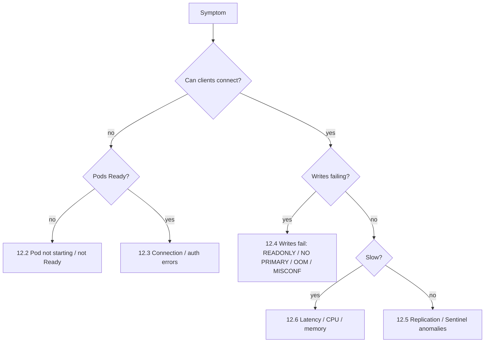

# Module 12: Troubleshooting runbook and day-2 checklist

[← Module 11](11-patching-and-upgrades.md) | [README](../README.md) | Next: [Cleanup →](99-cleanup.md)

**Goal:** a symptom-driven runbook that pulls together everything from the workshop, plus a day-2 operations checklist and a diagnostics bundle for Broadcom support.

📘 **Docs:** [Troubleshooting Tanzu for Valkey on Kubernetes](https://techdocs.broadcom.com/us/en/vmware-tanzu/data-solutions/tanzu-for-valkey-on-kubernetes/3-5/valkey-on-kubernetes/troubleshooting.html) · [Quick reference](https://techdocs.broadcom.com/us/en/vmware-tanzu/data-solutions/tanzu-for-valkey-on-kubernetes/3-5/valkey-on-kubernetes/quick-reference.html)

---

## 12.1 First five minutes of any incident

```bash
source ./env.sh
health-check.sh                                                  # 1. overall verdict
topology.sh                                                      # 2. writer, replicas, nodes, lag
kubectl get pods,pvc -n "$VALKEY_NS" -o wide                     # 3. pod state / restarts
kubectl get events -n "$VALKEY_NS" --sort-by=.lastTimestamp | tail -20   # 4. what Kubernetes saw
kubectl logs -n "$OPERATOR_NS" deploy/$OPERATOR_DEPLOY --since=15m | grep -iE 'error|fail' | tail   # 5. operator
```

Then open the Grafana dashboard and pick the matching symptom below.



## 12.2 Pods not starting or not Ready

| Symptom | Diagnose | Fix |
|---------|----------|-----|
| `ImagePullBackOff` / `ErrImagePull` | `kubectl describe pod` → events | create `valkey-registry-secret` in **this** namespace; check registry credentials |
| `Pending` | `kubectl describe pod` → `FailedScheduling` | not enough CPU/memory; *required* anti-affinity can't be satisfied; PVC bound to a zone without capacity; taints |
| `Pending` with PVC `Pending` | `kubectl get pvc`, `kubectl describe pvc` | no default StorageClass; the provisioner is failing |
| `CrashLoopBackOff` | `kubectl logs <pod> --previous` | bad config in the CR; PV permissions; OOMKilled (check *Last State*) |
| Running but `0/N Ready` | `kubectl describe pod` → `Readiness probe failed` | heartbeat auth: `valkeySecret` user missing from the ACL file, or lacking `+ping`/`+@connection`; protected mode; slow dataset load → add a `startupProbe` |
| Pods restart during large dataset load | liveness kills while loading the RDB | `spec.kubernetesConfig.startupProbe` (the docs recommend it over a bigger `initialDelaySeconds`) |
| CR stuck `Initializing` / `Scaling` | `kubectl describe valkeysentinel/valkeyreplication`, operator logs | usually one of the above on a specific pod |
| CR rejected on apply | webhook error message | compare with `kubectl explain`; removed fields (e.g. `valkeyReplicationSize`); webhook certificate (cert-manager) |
| Pod `OOMKilled` | `kubectl get pod -o jsonpath='{.status.containerStatuses[*].lastState}'` | raise `resources.instance.limits.memory`; set `maxmemory` below the limit; leave fork headroom |

## 12.3 Connection and authentication errors

| Error | Cause | Fix |
|-------|-------|-----|
| `NOAUTH Authentication required` | client sent no credentials | fix the client config/secret |
| `WRONGPASS invalid username-password pair` | wrong credentials, stale client after rotation | `ACL LOG`; compare the secret with the ACL file; roll the application |
| `NOPERM … no permissions to run the 'x' command` / `to access one of the keys` | ACL rule | `ACL GETUSER <u>`, `ACL DRYRUN <u> <cmd>`; update the ACL secret and roll pods |
| `DENIED Running in protected mode` | ACL active and `default` user on **without** password | give `default` a password (and align `valkeySecret`) or `user default off` |
| Timeouts from another namespace | NetworkPolicy | label the client namespace/pod (module 5) or adjust the policy |
| External client gets a `10.x` address from Sentinel and can't connect | Sentinel returns internal pod IPs | run the client in-cluster, use routable pod IPs, or a primary DNS/LB (module 5.6) |
| TLS handshake failures | SAN doesn't cover the pod FQDN; missing `clientAuth` EKU for mTLS; `clusterDomain` mismatch | reissue the certificate (module 5.8) |
| OAuth/LDAP users can't connect | wrong port; sidecar errors | connect to the auth port (6380); check `valkeySecret` has `+@admin`; sidecar logs |
| Commander/Admin shows connection errors | console auth or protected mode | console pod logs; `valkeySecret` / ACL |
| `max number of clients reached` | `maxclients` hit | find the leak (`CLIENT LIST`, group by `addr`/`user`); raise `maxClients` |

## 12.4 Writes failing

| Error / symptom | Meaning | Action |
|-----------------|---------|--------|
| `READONLY You can't write against a read only replica` | client writes to a replica | the client isn't Sentinel-aware or caches a stale primary; check its config; after failover, it must rediscover |
| Writes fail for 5–35 s, then recover | failover in progress | expected; tune `downAfterMilliseconds`; client timeouts and retries |
| `NO PRIMARY` / Sentinel returns nothing | no primary elected | `scli SENTINEL master …` flags; are ≥ 2 Sentinels up? `-failover-abort-no-good-slave` in the logs → no eligible replica |
| `OOM command not allowed when used memory > 'maxmemory'` | full, with `noeviction` | free memory / scale up memory; reconsider the policy for caches |
| `MISCONF Valkey is configured to save RDB snapshots, but it's currently unable to persist to disk` | BGSAVE failing → writes refused | PVC full (`kubectl exec … df -h`), fork ENOMEM (memory limit), storage errors in events |
| `-NOREPLICAS Not enough good replicas to write` | `min-replicas-to-write` not met | replicas down or lagging; fix replication |

## 12.5 Replication and Sentinel anomalies

| Symptom | Diagnose | Fix |
|---------|----------|-----|
| Replica `master_link_status:down` | replica logs (`Connection with master lost`, auth errors) | network, auth (replica → primary uses `default`), primary overloaded |
| Replicas in a **full resync loop** | logs: repeated `Full resync`; primary `client-output-buffer-limit` disconnects | replication backlog too small for the write rate (`repl-backlog-size`), slow network, buffer limits too low |
| Replication lag growing | dashboard; `INFO replication` offsets | replica CPU/network starved; big writes; full sync in progress |
| Two primaries (`ValkeyMultiplePrimaries`) | `topology.sh`, Sentinel logs, network events | partition; Sentinels on the majority side are authoritative; the old primary is demoted on heal; investigate the network; consider `min-replicas-to-write` |
| `ckquorum` fails | `scli SENTINEL sentinels`, Sentinel pod status | restore Sentinel pods; check anti-affinity (all on one node?) |
| Sentinels disagree on the primary | query each Sentinel (module 4 exercise) | wait for convergence after failover; Sentinel auth issues between peers; only `SENTINEL RESET` as a last resort |
| Unexpected failovers (flapping) | Sentinel logs `+sdown` timing; node events; GC/fork | `downAfterMilliseconds` too low; CPU throttling of the primary; noisy node; large BGSAVE fork pauses |
| Sentinel auth failures to Valkey | Sentinel logs | `valkeySecret` (Sentinel → Valkey) vs `sentinelSecret` (Sentinel API) mixed up |
| Sentinel won't load ACL | `Unknown command or category name` | only built-in ACL categories in the Sentinel ACL |
| `+tilt` in Sentinel logs | Sentinel process paused / clock jump | node CPU starvation or VM stun; check node health |

## 12.6 Performance: latency, CPU, memory

| Symptom | Diagnose | Fix |
|---------|----------|-----|
| High latency, Valkey CPU ≈ 1 core | `INFO commandstats`, `SLOWLOG GET`, top commands panel | expensive commands (`KEYS`, big `SMEMBERS`/`HGETALL`, Lua); fix the access pattern |
| High latency, CPU low | `--latency` from the client pod; `LATENCY DOCTOR`; throttling panel | CPU limit throttling; network; fork/AOF fsync spikes; noisy neighbours |
| Memory climbing | `INFO memory`, `--bigkeys`, `--memkeys`, keys without TTL | missing TTLs; big keys; set `maxmemory` + a policy |
| Fragmentation > 1.5 on a large dataset | dashboard | `CONFIG SET activedefrag yes`; rolling restart (replicas, failover, old primary) |
| Fragmentation < 1 | node swapping | node memory pressure; fix requests/limits; avoid swap on the nodes |
| Evictions | `evicted_keys` panel | expected for a cache at maxmemory; otherwise add memory |
| Hit rate dropped | dashboard after deploy/failover/eviction | cold cache after a restore; key-pattern change; evictions |
| Many new connections/s | `connections_received` panel | the client isn't pooling |

## 12.7 Backup, restore, upgrade

| Symptom | Diagnose | Fix |
|---------|----------|-----|
| Backup `Pending`/`Failed` | `kubectl describe valkeybackup`, `kubectl logs <primary> -c persistence`, operator logs | S3 endpoint/credentials/bucket, `bucketPath` must end with `/`, instance not running, persistence disabled |
| Backup refers to the wrong object | `valkeyInstance` | for Sentinel, use the **ValkeyReplication** name |
| Restore `Failed` | `kubectl describe valkeyrestore` | backup not found / not `Succeeded`; target ACL/credentials secrets missing; insufficient storage; different namespace |
| Version upgrade stuck | `kubectl describe valkeyversionupgrade`, operator logs, pod events | target version not in `kubectl get valkeyversions`; persistence disabled; backup location wrong |
| Instance `Failed` after an operator upgrade | release notes | Valkey version no longer supported; upgrade the instance version |

## 12.8 Diagnostics bundle for Broadcom support

```bash
collect-diagnostics.sh
# -> valkey-diag-YYYYMMDD-HHMMSS.tar.gz
```

It collects: Kubernetes and node info, the Helm release, CRDs, `ValkeyVersion`/`ValkeyImageSet`, all Valkey CRs, pods/PVCs/PDBs/events, `describe` output, current **and previous** logs of every container, the operator log, `INFO` sections, `SLOWLOG`, `LATENCY`, `MEMORY DOCTOR` and the Sentinel view. Secrets are listed **by name only**. Review the bundle before you share it.

## 12.9 Day-2 operations checklist

**Daily (or automated by alerts)**
- [ ] No firing critical alerts (`ValkeyInstanceDown`, `ValkeyNoPrimary`, `ValkeyMultiplePrimaries`, `ValkeyReplicaLinkDown`, `ValkeyRdbSaveFailed`)
- [ ] Latest scheduled backup `Succeeded`
- [ ] Failovers in the last 24 h explained (`ValkeyFailoverOccurred`, Sentinel `+switch-master`)

**Weekly**
- [ ] Capacity trends: memory vs maxmemory/limit, CPU, connections, PVC usage
- [ ] Fragmentation, evictions, hit rate within expected ranges
- [ ] Slowlog review with the application teams
- [ ] Placement check (`topology.sh`): no co-located data pods or Sentinels

**Monthly / per release**
- [ ] Release notes and CVEs reviewed; patch plan (operator, image set, Valkey version)
- [ ] Restore test into a throwaway instance (module 10.6)
- [ ] Credentials rotation per policy (module 5.4)
- [ ] Certificate expiry > 30 days (if TLS)

**Twice a year**
- [ ] DR drill: promote the DR site, measure RTO/RPO, fail back (module 10.7)
- [ ] Failover game day with the application teams (module 9)

---

[← Module 11](11-patching-and-upgrades.md) | [README](../README.md) | Next: [Cleanup →](99-cleanup.md)
